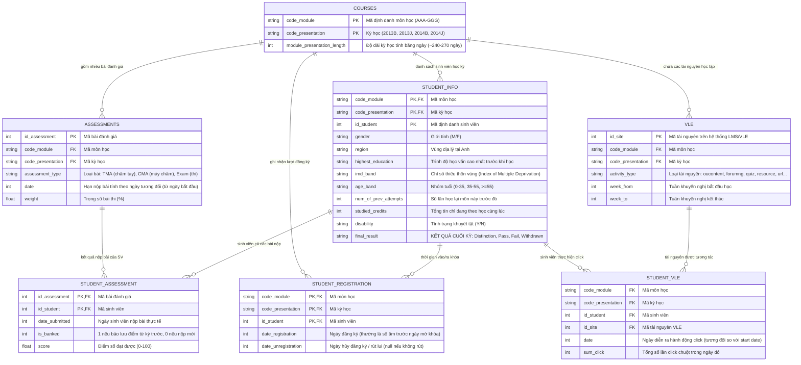

# KIẾN TRÚC VÀ SƠ ĐỒ QUAN HỆ DỮ LIỆU OULAD
## Open University Learning Analytics Dataset (Kuzilek et al., 2017)

---

## 1. SƠ ĐỒ QUAN HỆ THỰC THỂ (ENTITY RELATIONSHIP DIAGRAM - ERD)

Dưới đây là sơ đồ quan hệ chuẩn giữa 7 bảng dữ liệu của OULAD:

---

## 2. TỪ ĐIỂN DỮ LIỆU CHI TIẾT (DATA DICTIONARY)

### 2.1. courses.csv (22 dòng)
- Mô tả: Danh mục các module và kỳ học có trong bộ dữ liệu.
- Các kỳ học:
  - `B`: Kỳ mùa xuân (B = February/March).
  - `J`: Kỳ mùa thu (J = October).
- `module_presentation_length`: Tổng số ngày khóa học diễn ra chính thức (từ ngày 0 đến khi bế giảng, thường từ 234 đến 269 ngày).

### 2.2. studentInfo.csv (32,593 dòng)
- Mô tả: Bảng trung tâm chứa thông tin nhân khẩu học và kết quả học tập cuối cùng.
- **Khóa chính kết hợp (Composite Key)**: `(code_module, code_presentation, id_student)`.
  > *Lưu ý quan trọng*: Một sinh viên (`id_student`) có thể đăng ký nhiều môn hoặc học lại nhiều kỳ khác nhau!
- **Biến mục tiêu (`final_result`)**:
  - `Pass`: Đỗ môn học (đạt điểm yêu cầu).
  - `Distinction`: Đỗ xuất sắc.
  - `Fail`: Trượt môn (không đạt điểm sàn hoặc không hoàn thành bài thi bắt buộc).
  - `Withdrawn`: Rút lui/bỏ học giữa chừng trước khi kết thúc khóa.

### 2.3. studentRegistration.csv (32,593 dòng)
- `date_registration`: Ngày đăng ký so với mốc bắt đầu môn học. Giá trị âm nghĩa là đăng ký trước ngày khai giảng (ví dụ `-30` là đăng ký trước 30 ngày).
- `date_unregistration`: Ngày sinh viên hủy môn. Giá trị `NaN` biểu thị sinh viên hoàn thành khóa học mà không rút lui. Nếu có giá trị, sinh viên đó thường có `final_result = Withdrawn`.

### 2.4. assessments.csv (206 dòng)
- `assessment_type`:
  - `TMA` (Tutor-Marked Assessment): Bài tập lớn / tiểu luận do giảng viên chấm.
  - `CMA` (Computer-Marked Assessment): Bài trắc nghiệm tự động trên máy tính.
  - `Exam`: Bài thi kết thúc môn.
- `weight`: Trọng số của bài thi tính theo % tổng điểm môn học.
- `date`: Ngày hạn chót nộp bài (tính từ ngày 0 của khóa học).

### 2.5. studentAssessment.csv (173,912 dòng)
- `score`: Điểm số bài nộp thang điểm 0-100.
- `date_submitted`: Ngày nộp bài thực tế của sinh viên.
  - Nếu `date_submitted <= assessments.date`: Nộp đúng hạn hoặc trước hạn.
  - Nếu `date_submitted > assessments.date`: Nộp trễ hạn (chỉ số cảnh báo suy giảm nhận thức/trì hoãn).
- `is_banked`: Cờ báo điểm bảo lưu (sinh viên học lại môn và dùng điểm của kỳ trước). Cần lọc hoặc xử lý đặc biệt để tránh sai lệch dữ liệu nộp bài kỳ hiện tại.

### 2.6. vle.csv (6,364 dòng)
- Danh mục tài nguyên trực tuyến trên VLE Moodle.
- Các `activity_type` phổ biến nhất:
  - `oucontent`: Nội dung bài giảng điện tử chính (e-learning pages).
  - `forumng`: Diễn đàn thảo luận (Next-Gen Forum).
  - `quiz`: Bài trắc nghiệm tự luyện / kiểm tra ngắn.
  - `homepage`: Trang chủ môn học.
  - `subpage`: Trang tài liệu phụ.
  - `resource`: File PDF, tài liệu tải về.
  - `url`: Đường dẫn liên kết ra ngoài.
  - `ouwiki`: Hoạt động wiki nhóm hợp tác.

### 2.7. studentVle.csv (10,655,280 dòng)
- Đây là bảng dữ liệu lớn nhất (Big Data log) ghi lại toàn bộ hành vi của sinh viên.
- Mỗi bản ghi thể hiện: *Sinh viên X vào ngày Y đã click vào tài nguyên Z tổng cộng N lần*.
- `date`:
  - `date < 0`: Tương tác diễn ra trước ngày khai giảng (sẵn sàng chuẩn bị học).
  - `date >= 0`: Tương tác trong suốt khóa học.

---

## 3. CƠ CHẾ NỐI DỮ LIỆU (JOIN KEYS & CARDINALITY)

| Bảng nguồn (Left) | Bảng đích (Right) | Cột nối (Join Keys) | Quan hệ (Cardinality) |
|---|---|---|---|
| `courses` | `assessments` | `code_module`, `code_presentation` | 1 - N |
| `courses` | `vle` | `code_module`, `code_presentation` | 1 - N |
| `courses` | `studentInfo` | `code_module`, `code_presentation` | 1 - N |
| `studentInfo` | `studentRegistration` | `code_module`, `code_presentation`, `id_student` | 1 - 1 |
| `studentInfo` | `studentAssessment` | `id_student` (lọc theo `id_assessment` thuộc môn) | 1 - N |
| `assessments` | `studentAssessment` | `id_assessment` | 1 - N |
| `vle` | `studentVle` | `id_site` (`code_module`, `code_presentation`) | 1 - N |
| `studentInfo` | `studentVle` | `code_module`, `code_presentation`, `id_student` | 1 - N |

---

## 4. BẢI TOÁN PHÂN LOẠI & GÁN NHÃN MỤC TIÊU (TARGET MAPPING)

| final_result gốc | Tỷ lệ trong OULAD | Bài toán Nhị phân (Binary - Chính) | Bài toán 4-lớp (Multi-class) |
|---|---|---|---|
| **Distinction** | ~13% | **0 (Not At-Risk / Thành công)** | 0 - Distinction |
| **Pass** | ~38% | **0 (Not At-Risk / Thành công)** | 1 - Pass |
| **Fail** | ~16% | **1 (At-Risk / Nguy cơ)** | 2 - Fail |
| **Withdrawn** | ~33% | **1 (At-Risk / Nguy cơ)** | 3 - Withdrawn |

**Tổng tỷ lệ phân loại nhị phân**:
- **0 (Not At-Risk)**: ~51%
- **1 (At-Risk)**: ~49%
> Dữ liệu nhị phân tương đối cân bằng về mặt số lượng tổng thể (51% vs 49%), nhưng trong nhóm At-Risk có sự khác biệt hành vi rõ rệt giữa sinh viên trượt (Fail - vẫn học đến cuối) và sinh viên bỏ ngang (Withdrawn - dừng tương tác sớm).
