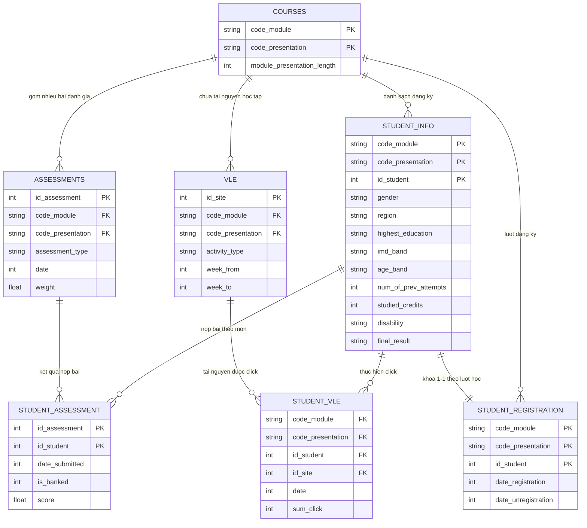

# CẨM NANG GIẢI MÃ TOÀN DIỆN BỘ DỮ LIỆU OULAD
## Hiểu trọn vẹn cấu trúc 7 bảng dữ liệu, hệ thống tín chỉ Vương quốc Anh, cơ chế đăng ký học phần và các cạm bẫy kỹ thuật

**Dự án:** LMS Tiên tiến và Learning Analytics (Phân tích Dữ liệu Học tập)  
**Tác giả đồ án:** Vũ Hoà Bình (MSSV 202416137)  
**Bộ dữ liệu mục tiêu:** Open University Learning Analytics Dataset (OULAD) `[Kuzilek et al., 2017]`  
**Mục đích tài liệu:** Cung cấp cái nhìn đầy đủ, trực quan và chính xác nhất về toàn bộ bộ dữ liệu thô OULAD (từ bối cảnh đào tạo thực tế ở Vương quốc Anh, quy trình sinh viên đăng ký – học – thi – rút môn, ý nghĩa từng cột trong 7 tệp CSV, cho tới các ngoại lệ dữ liệu và cạm bẫy kỹ thuật trong quá trình tiền xử lý, trích xuất đặc trưng và mô hình hóa).

---

## MỤC LỤC NHANH
1. [Tổng quan nguồn gốc & quy mô bộ dữ liệu OULAD](#1-tổng-quan-nguồn-gốc--quy-mô-bộ-dữ-liệu-oulad)
2. [Hệ thống tín chỉ UK (CATS) & Cách sinh viên đăng ký, theo học, rút môn, học lại](#2-hệ-thống-tín-chỉ-uk-cats--cách-sinh-viên-đăng-ký-theo-học-rút-môn-học-lại)
3. [Giải mã chi tiết từng bảng và từng cột trong 7 tệp CSV](#3-giải-mã-chi-tiết-từng-bảng-và-từng-cột-trong-7-tệp-csv)
4. [8 "Cạm bẫy" và đặc thù kỹ thuật bắt buộc phải biết](#4-8-cạm-bẫy-và-đặc-thù-kỹ-thuật-bắt-buộc-phải-biết)
5. [Dòng chảy dữ liệu trong Pipeline Project_I](#5-dòng-chảy-dữ-liệu-trong-pipeline-project_i)
6. [Tài liệu tham khảo](#6-tài-liệu-tham-khảo)

---

## 1. TỔNG QUAN NGUỒN GỐC & QUY MÔ BỘ DỮ LIỆU OULAD

### 1.1. Bối cảnh ra đời và đặc thù người học
Bộ dữ liệu **OULAD (Open University Learning Analytics Dataset)** được thu thập và công bố bởi các nhà nghiên cứu tại **The Open University (OU)** — trường đại học công lập chuyên về đào tạo từ xa lớn nhất Vương quốc Anh — trên tạp chí *Scientific Data (Nature)* `[Kuzilek et al., 2017]`.

Để hiểu đúng các con số trong OULAD (tại sao tỷ lệ rút môn cao, tại sao độ tuổi trải rộng từ dưới 35 tới trên 55, tại sao có người học 30 hay 60 tín chỉ một năm), cần nắm rõ **3 đặc thù rất khác** so với đại học chính quy tại Việt Nam:
1. **Đào tạo từ xa hoàn toàn qua LMS/VLE:** Sinh viên học trực tuyến trên hệ thống **VLE (Virtual Learning Environment)** xây dựng trên nền tảng Moodle. Toàn bộ bài giảng điện tử, diễn đàn trao đổi, bài luyện tập và nộp bài kiểm tra đều diễn ra trực tuyến (riêng một số kỳ thi kết thúc môn `Exam` được tổ chức tập trung).
2. **Mở cửa tuyển sinh (Open Entry):** Phần lớn các chương trình bậc đại học của OU không áp đặt kỳ thi tuyển đầu vào gắt gao. Vì vậy, trình độ đầu vào của người học trải rộng từ chưa có bằng cấp chính thức (`No Formal quals`) đến đã có bằng sau đại học (`Post Graduate Qualification`).
3. **Đa số học bán thời gian (Part-time) và vừa làm vừa học:** Rất nhiều sinh viên là người trưởng thành đã đi làm hoặc có gia đình, phải tự thu xếp thời gian tự học ngoài giờ. Đây là nguyên nhân cốt lõi khiến tải tín chỉ (`studied_credits`) và biến cố đời sống ảnh hưởng trực tiếp tới tỷ lệ bỏ học giữa chừng (`Withdrawn`, chiếm tới **31.16%**).

### 1.2. Quy mô tổng thể (7 tệp CSV trong `data/raw/`)
Tổng dung lượng giải nén của 7 tệp CSV là khoảng **442.86 MB**, bao phủ **7 môn học** (`AAA`–`GGG`), **22 lớp học phần** trong giai đoạn **2013–2014**, gồm **28,785 sinh viên duy nhất**, tạo thành **32,593 lượt đăng ký học phần**, **173,912 bài nộp đánh giá**, **6,364 tài nguyên học tập VLE** và **10,655,280 dòng log tương tác** (tổng cộng **39,605,099 lượt click**).

| STT | Tên tệp CSV | Dung lượng | Số dòng | Số cột | Khóa chính (Primary Key) | Giá trị thiếu (Null) | Vai trò nghiệp vụ |
|:---:|---|---:|---:|---:|---|---:|---|
| 1 | `courses.csv` | < 0.01 MB | 22 | 3 | `(code_module, code_presentation)` | 0 | Danh mục 22 lớp học phần và thời lượng (ngày) |
| 2 | `assessments.csv` | 0.01 MB | 206 | 6 | `id_assessment` | 11 | Cấu trúc, loại hình, hạn nộp và trọng số các bài đánh giá |
| 3 | `vle.csv` | 0.25 MB | 6,364 | 6 | `id_site` | 10,486 | Danh mục tài nguyên học tập số trên hệ thống VLE |
| 4 | `studentInfo.csv` | 3.30 MB | 32,593 | 12 | `(code_module, code_presentation, id_student)` | 1,111 | Hồ sơ nhân khẩu học, tải tín chỉ, số lần học lại & kết quả cuối kỳ |
| 5 | `studentRegistration.csv` | 1.06 MB | 32,593 | 5 | `(code_module, code_presentation, id_student)` | 22,566 | Nhật ký ngày đăng ký và ngày rút môn (nếu có) |
| 6 | `studentAssessment.csv` | 5.43 MB | 173,912 | 5 | `(id_assessment, id_student)` | 173 | Nhật ký nộp bài, cờ bảo lưu điểm và điểm số (0–100) |
| 7 | `studentVle.csv` | 432.81 MB | 10,655,280 | 6 | Không có khóa đơn (ghi mức phiên/ngày) | 0 | Big Data log ghi nhận số lượt click theo ngày và tài nguyên |

### 1.3. Sơ đồ quan hệ giữa 7 bảng (ERD) và tính toàn vẹn khóa ngoại



**Hai điểm quan trọng về liên kết dữ liệu:**
- **Khóa chính tổ hợp `(code_module, code_presentation, id_student)`:** Một dòng trong `studentInfo.csv` không phải là "1 người" mà là **"1 lượt đăng ký của 1 sinh viên vào 1 lớp học phần cụ thể"**. Cùng một `id_student` có thể xuất hiện ở nhiều dòng khác nhau nếu người đó học nhiều môn hoặc học lại qua nhiều kỳ.
- **Tính toàn vẹn quan hệ đạt 100%:** Kết quả kiểm tra trong [WEEK2_DATA_QUALITY_REPORT.md](file:///C:/Users/mrore/Project_I/reports/WEEK2_DATA_QUALITY_REPORT.md#L55-L64) xác nhận **0 bản ghi mồ côi** trên toàn bộ các khóa ngoại giữa 7 bảng (100% khớp giữa `studentVle`, `studentAssessment`, `studentRegistration`, `assessments`, `vle` và `studentInfo`).

---

## 2. HỆ THỐNG TÍN CHỈ UK (CATS) & CÁCH SINH VIÊN ĐĂNG KÝ, THEO HỌC, RÚT MÔN, HỌC LẠI

### 2.1. Vì sao 1 môn học ở đây tới 30 hoặc 60 tín chỉ? (So sánh UK vs. Việt Nam)
Vương quốc Anh áp dụng khung tín chỉ **CATS (Credit Accumulation and Transfer Scheme)** do Cơ quan Đảm bảo Chất lượng Giáo dục Đại học Anh (QAA) ban hành `[QAA, 2008]`. Đơn vị đo lường của hệ này lớn hơn rất nhiều so với hệ tín chỉ ở Việt Nam hoặc Mỹ vì **cách định nghĩa khác nhau hoàn toàn**:

| Tiêu chí so sánh | Việt Nam (ví dụ HUST) / Hệ Mỹ | Vương quốc Anh (Hệ CATS / The Open University) |
|---|---|---|
| **Bản chất 1 tín chỉ** | Chủ yếu tính theo **giờ lên lớp lý thuyết** (~15 tiết trên lớp/tín chỉ + tự học đi kèm) | Tính theo **tổng thời gian học trọn gói**: **1 tín chỉ = 10 giờ học** (gồm đọc giáo trình, học trên VLE, làm bài tập, ôn thi) `[QAA, 2008]` |
| **Quy mô 1 môn học (Module)** | Thường **2–4 tín chỉ** (học trong ~15 tuần) | Thường là **30 tín chỉ** (~300 giờ học) hoặc **60 tín chỉ** (~600 giờ học), kéo dài **8–9 tháng** `[OU Study Guide]` |
| **Tải học Toàn thời gian (1 năm)** | ~30–36 tín chỉ/năm (~15–18 tín chỉ/kỳ) | **120 tín chỉ/năm** (~1,200 giờ học/năm, tương đương ~32–36 giờ/tuần) `[OU Study Guide]` |
| **Tải học Bán thời gian (1 năm)** | Ít phổ biến | **60 tín chỉ/năm** (~600 giờ học/năm, tương đương ~16–18 giờ/tuần) — *mức chuẩn của OU* |
| **Tổng tín chỉ tốt nghiệp Cử nhân** | ~130–160 tín chỉ (4 năm) | **360 tín chỉ** (3 năm Full-time hoặc 6 năm Part-time) `[QAA, 2008]` |

> **Công thức quy đổi nhanh để dễ hình dung:**  
> **60 tín chỉ UK (CATS) $\approx$ 30 tín chỉ châu Âu (ECTS) $\approx$ 15–18 tín chỉ Việt Nam** (tương đương 1 học kỳ toàn thời gian ở Việt Nam, nhưng được trải dài thành 8–9 tháng để người đi làm có thể theo kịp).

Vì vậy, khi thấy trong OULAD một sinh viên có `studied_credits = 60` hay `120`, điều đó **không có nghĩa** họ đang học 20–40 môn cùng lúc như ở Việt Nam, mà thường chỉ là **1 môn lớn (60 tín chỉ)** hoặc **2 môn lớn (120 tín chỉ)**.

### 2.2. Dòng thời gian (Timeline) đăng ký, theo học, rút môn và học lại của một sinh viên

```
  Ngày -322 ... -57 (median)      Ngày -25           Ngày 0             Ngày +27 (median rút)        Ngày 234 ~ 269
  ├───────────────────────────────┼──────────────────┼──────────────────┼─────────────────────────────┼─────────────────►
  │ Đăng ký môn học               │ VLE bắt đầu mở   │ KHAI GIẢNG       │ Nộp TMA/CMA, học VLE        │ Thi cuối kỳ (Exam)
  │ (date_registration < 0)       │ (6.47% dòng      │ (Start Date)     │ Hoặc xin rút môn            │ & Bế giảng khóa
  │ Một số hủy giữ chỗ (<0)       │  click < 0)      │                  │ (date_unregistration > 0)   │ (final_result)
```

Quy trình thực tế của sinh viên tại OU được phản ánh qua từng giai đoạn trong dữ liệu thô:

1. **Bước 1 — Chọn môn (`code_module`) và đợt khai giảng (`code_presentation`):**
   - Mỗi năm OU thường mở 2 đợt khai giảng chính `[Kuzilek et al., 2017]`:
     - **Kỳ `B` (February — Khai giảng tháng 2):** `2013B`, `2014B`, kéo dài **234–241 ngày** (~8 tháng).
     - **Kỳ `J` (October — Khai giảng tháng 10):** `2013J`, `2014J`, kéo dài **261–269 ngày** (~9 tháng).
   - Trong 7 môn của OULAD (dựa theo mức `studied_credits` tối thiểu ghi nhận ở từng môn):
     - **4 môn quy mô 60 tín chỉ:** `AAA`, `BBB`, `DDD`, `FFF`.
     - **3 môn quy mô 30 tín chỉ:** `CCC`, `EEE`, `GGG`.
   - Một sinh viên (`id_student`) có thể học **1 môn hoặc nhiều môn cùng kỳ**, hoặc học nối tiếp qua các kỳ. Cụ thể trong **28,785** sinh viên duy nhất:
     - **25,247** sinh viên xuất hiện **1 lượt** trong OULAD.
     - **3,293** sinh viên xuất hiện **2 lượt**; **221** sinh viên **3 lượt**; **23** sinh viên **4 lượt**; **1** sinh viên **5 lượt**.
     - Xét trong **cùng một đợt khai giảng (`code_presentation`)**: có **1,075** trường hợp sinh viên học **2 môn song song** trong OULAD và **3** trường hợp học **3 môn song song** trong OULAD.

2. **Bước 2 — Đăng ký trước ngày khai giảng (`date_registration`):**
   - Ngày khai giảng khóa học được quy ước là **ngày `0`**. Mọi mốc thời gian đều là **số ngày tương đối** so với ngày `0` (cách chuẩn hóa ẩn danh ngày tháng thực tế của OULAD).
   - Sinh viên thường đăng ký trước khai giảng vài tháng nên `date_registration` chủ yếu là **số âm**: sớm nhất **`-322`** ngày, trung vị **`-57`** ngày, trung bình **`-69.4`** ngày. Chỉ có **234** lượt đăng ký muộn sau ngày `0` (tối đa `+167`) và **45** lượt bị thiếu (`NaN`).

3. **Bước 3 — Truy cập tài nguyên chuẩn bị & học suốt kỳ (`studentVle`):**
   - Hệ thống VLE cho phép sinh viên vào làm quen tài liệu từ trước khai giảng (sớm nhất ngày **`-25`**). Có tới **688,988** dòng log (`6.47%` tổng số dòng `studentVle`) phát sinh khi `date < 0`.

4. **Bước 4 — Hoàn thành khóa học hoặc rút môn (`date_unregistration`):**
   - **Theo học đến cuối khóa:** Cột `date_unregistration` để trống (`NaN`, **22,521** lượt) $\rightarrow$ kết quả cuối kỳ (`final_result`) là `Distinction`, `Pass` hoặc `Fail`.
   - **Xin rút môn giữa chừng:** Có **10,072** lượt có giá trị ở `date_unregistration`:
     - **2,678** lượt rút **trước ngày khai giảng (`< 0`)** (sớm nhất `-365`): đăng ký giữ chỗ rồi hủy trước khi vào học chính thức (tương tự hủy học phần trước khi vào kỳ ở Việt Nam).
     - **419** lượt rút **đúng ngày khai giảng (`= 0`)**.
     - **6,975** lượt rút **sau ngày khai giảng (`> 0`)**: bỏ cuộc trong quá trình học (tối đa ghi nhận `+444`).

5. **Bước 5 — Học lại (`num_of_prev_attempts`) và bảo lưu điểm (`is_banked`):**
   - Nếu kỳ trước trượt (`Fail`) hoặc rút (`Withdrawn`), sinh viên được phép đăng ký học lại đúng môn đó vào đợt sau, khi đó `num_of_prev_attempts` tăng lên `1, 2, ..., 6`.
   - *Ví dụ thực tế từ `studentInfo.csv`:* Sinh viên `id_student = 80329` từng rút môn `DDD` ở kỳ `2013J` (`num_of_prev_attempts = 1`), rút môn `CCC` ở kỳ `2014B` (`num_of_prev_attempts = 0`), sau đó quay lại đăng ký học lại cả hai môn `CCC` (`prev = 1`) và `DDD` (`prev = 2`) ở kỳ `2014J` và đều đạt `Pass`.
   - Khi học lại, sinh viên có thể được **bảo lưu điểm một số bài đánh giá** từ kỳ trước — trong `studentAssessment.csv` đánh dấu bằng cờ `is_banked = 1` (**1,909** bản ghi, toàn bộ đều có `date_submitted = -1`).

### 2.3. Hai điểm dễ hiểu nhầm nhất về cột `studied_credits`

1. **`studied_credits` là TỔNG tín chỉ đang học ĐỒNG THỜI trên toàn trường OU, không chỉ riêng 7 môn OULAD:**
   - OULAD chỉ công bố dữ liệu của **7 môn học** đại diện (`AAA`–`GGG`) trong hàng trăm môn của toàn trường.
   - Do đó, một sinh viên có thể chỉ có **1 dòng** trong OULAD (ví dụ đang học môn `CCC` = 30 tín chỉ), nhưng `studied_credits` ghi **`120`**. Điều này có nghĩa là tại cùng thời điểm đó, họ đang học thêm **90 tín chỉ** ở các môn khác không nằm trong phạm vi xuất bản của OULAD.
   - Phân bố thực tế của `studied_credits` tập trung áp đảo vào các bội số của `30`:
     - `30` tín chỉ: **3,749** lượt (11.5% — 1 môn 30 tín chỉ)
     - `60` tín chỉ: **16,751** lượt (**51.4%** — *mode* và *median* của toàn bộ dữ liệu, tương ứng mức chuẩn Part-time)
     - `90` tín chỉ: **3,144** lượt (9.6% — 1 môn 60 + 1 môn 30)
     - `120` tín chỉ: **6,328** lượt (19.4% — mức chuẩn Full-time)
     - Còn lại là các mức tổ hợp ít gặp (ví dụ `40, 45, 70, 75, 150, 180...`) và ngoại lai trên `300`.

2. **Ngoại lai lên tới `655` tín chỉ và lý do ngưỡng `60` tín chỉ (`credit_overload`) được chọn làm mốc cảnh báo:**
   - **Ngoại lai (`> 300` đến `655`):** Chỉ có **35 / 32,593** lượt (~0.11%) ghi nhận `> 300` tín chỉ (max `655`), thường phát sinh do chồng chéo các học phần chuyển tiếp giữa các kỳ B/J hoặc bất thường ghi sổ hành chính. Do vậy ở Tuần 4 ([WEEK4_DATA_PREPROCESSING_REPORT.md](file:///C:/Users/mrore/Project_I/reports/WEEK4_DATA_PREPROCESSING_REPORT.md#L84-L98)), dự án đã chặn trần Winsorization tại ngưỡng **`300` tín chỉ**.
   - **Ý nghĩa ngưỡng `60` tín chỉ:** Vì sinh viên OU chủ yếu học bán thời gian, mức **60 tín chỉ** (~16–18 giờ tự học/tuần) là ngưỡng "vừa sức". Số liệu thực tế trên toàn bộ **32,593** lượt đăng ký cho thấy tỷ lệ rủi ro trượt/rút môn (`At-Risk = Fail + Withdrawn`) **tăng đơn điệu rất mạnh** ngay khi vượt ngưỡng 60 tín chỉ:

| Khoảng `studied_credits` | Số lượt đăng ký | Tỷ lệ `At-Risk` | Diễn giải tải học tập |
|---|---:|---:|---|
| `(0, 30]` | 3,749 | **43.72%** | Nhẹ (1 môn 30 tín chỉ) |
| `(30, 60]` | 16,819 | **49.20%** | Mức chuẩn Part-time (1 môn 60 hoặc 2 môn 30) |
| `(60, 90]` | 3,379 | **56.32%** | Bắt đầu vượt tải bán thời gian (`credit_overload = 1`) |
| `(90, 120]` | 6,390 | **59.78%** | Tải Full-time (~32–36 giờ/tuần, áp lực cao cho người đi làm) |
| `(120, 180]` | 1,715 | **67.41%** | Quá tải nặng (tương đương 1.5 lần Full-time) |
| `> 180` | 541 | **76.71%** | Cực kỳ quá tải / chồng chéo kỳ học |

---

## 3. GIẢI MÃ CHI TIẾT TỪNG BẢNG VÀ TỪNG CỘT TRONG 7 TỆP CSV

### 3.1. `courses.csv` — Danh mục 22 lớp học phần (22 dòng, 3 cột)
Bảng này liệt kê 7 môn học (`AAA`–`GGG`) được mở qua tối đa 4 đợt (`2013B`, `2013J`, `2014B`, `2014J`):
- **`code_module`**: Mã môn học ẩn danh (`AAA` đến `GGG`). Theo phân loại của `[Kuzilek et al., 2017]`, `AAA`, `BBB`, `GGG` thuộc khối **Khoa học Xã hội (Social Sciences)**, còn `CCC`, `DDD`, `EEE`, `FFF` thuộc khối **Khoa học Tự nhiên – Công nghệ – Kỹ thuật – Toán (STEM)**.
- **`code_presentation`**: Mã đợt khai giảng (`B` = tháng 2, `J` = tháng 10).
- **`module_presentation_length`**: Độ dài chính thức của khóa học tính bằng ngày (từ `234` đến `269` ngày).

**Tổng hợp hồ sơ từng môn học từ `courses.csv` và `studentInfo.csv`:**

| Môn học | Khối ngành `[Kuzilek et al., 2017]` | Các kỳ mở lớp (và số ngày) | Tín chỉ tối thiểu | Số lượt đăng ký | Tỷ lệ `Distinction` | Tỷ lệ `Pass` | Tỷ lệ `Fail` | Tỷ lệ `Withdrawn` | Tổng `At-Risk` |
|:---:|---|---|---:|---:|---:|---:|---:|---:|---:|
| **`AAA`** | Social Sciences | `2013J` (268), `2014J` (269) | 60 | 748 | 5.88% | 65.11% | 12.17% | 16.84% | **29.01%** |
| **`BBB`** | Social Sciences | `2013B` (240), `2013J` (268), `2014B` (234), `2014J` (262) | 60 | 7,909 | 8.56% | 38.91% | 22.35% | 30.19% | **52.54%** |
| **`CCC`** | STEM | `2014B` (241), `2014J` (269) | 30 | 4,434 | 11.23% | 26.61% | 17.61% | **44.54%** | **62.16%** |
| **`DDD`** | STEM | `2013B` (240), `2013J` (261), `2014B` (241), `2014J` (262) | 60 | 6,272 | 6.11% | 35.51% | 22.51% | 35.87% | **58.39%** |
| **`EEE`** | STEM | `2013J` (268), `2014B` (241), `2014J` (269) | 30 | 2,934 | 12.13% | 44.10% | 19.15% | 24.61% | **43.76%** |
| **`FFF`** | STEM | `2013B` (240), `2013J` (268), `2014B` (241), `2014J` (269) | 60 | 7,762 | 8.63% | 38.37% | 22.04% | 30.96% | **53.00%** |
| **`GGG`** | Social Sciences | `2013J` (261), `2014B` (241), `2014J` (269) | 30 | 2,534 | 15.63% | 44.12% | **28.73%** | 11.52% | **40.25%** |

> **Nhận xét nhanh:** Có sự phân hóa rất mạnh theo môn học: `CCC` có tỷ lệ rút môn và nguy cơ cao nhất (**62.16%** At-Risk, **44.54%** rút môn), trong khi `AAA` có tỷ lệ đậu cao nhất (**70.99%** Pass + Distinction). Đặc biệt `GGG` có tỷ lệ rút rất thấp (**11.52%**) nhưng tỷ lệ `Fail` cao nhất (**28.73%**).

---

### 3.2. `studentInfo.csv` — Hồ sơ nhân khẩu học & kết quả cuối kỳ (32,593 dòng, 12 cột)

| Cột | Kiểu dữ liệu | Giá trị & Phân bố thực tế (N = 32,593) | Ý nghĩa chi tiết & Quy đổi dễ hiểu |
|---|---|---|---|
| `code_module` | Chuỗi | `AAA`–`GGG` (7 giá trị) | Mã môn học (xem bảng mục 3.1) |
| `code_presentation` | Chuỗi | `2013B`, `2013J`, `2014B`, `2014J` | Đợt khai giảng của lớp học phần |
| `id_student` | Số nguyên | **28,785** mã duy nhất | Mã định danh ẩn danh của sinh viên |
| `gender` | Chuỗi | `M`: **17,875** (54.84%); `F`: **14,718** (45.16%) | Giới tính Nam (`M`) / Nữ (`F`) |
| `region` | Chuỗi | 13 vùng địa lý Vương quốc Anh & Ireland | Nhiều nhất: *Scotland* (3,446), *East Anglian Region* (3,340), *London Region* (3,216), *South Region* (3,092); ít nhất: *Ireland* (1,184) |
| `highest_education` | Chuỗi (Thứ tự) | `No Formal quals`: **347** (1.06%)<br>`Lower Than A Level`: **13,158** (40.37%)<br>`A Level or Equivalent`: **14,045** (43.09%)<br>`HE Qualification`: **4,730** (14.51%)<br>`Post Graduate Qualification`: **313** (0.96%) | Trình độ học vấn cao nhất trước khi vào học:<br>- *No Formal quals*: Chưa có bằng chính quy<br>- *Lower Than A Level*: Tương đương THCS / chưa hết THPT (dưới chuẩn tốt nghiệp THPT Anh)<br>- *A Level or Equivalent*: Tương đương bằng Tốt nghiệp THPT<br>- *HE Qualification*: Bằng Cao đẳng / Đại học (Higher Education)<br>- *Post Graduate Qualification*: Sau đại học (Thạc sĩ / Tiến sĩ) |
| `imd_band` | Chuỗi (Thứ tự) | 10 mức decile từ `0-10%` đến `90-100%`; **1,111 giá trị `NaN` (3.41%)** | Chỉ số thiếu thốn đa chiều tại Anh — **Index of Multiple Deprivation (IMD)** `[MHCLG, 2015]`:<br>- `0-10%`: Thuộc **10% khu vực khó khăn/thiếu thốn nhất** (thu nhập, việc làm, giáo dục, y tế...)<br>- `90-100%`: Thuộc **10% khu vực khá giả nhất**<br>- **Lưu ý lỗi dữ liệu gốc:** Mức `10-20%` bị ghi thiếu dấu `%` thành **`'10-20'`** (3,516 dòng) |
| `age_band` | Chuỗi (Thứ tự) | `0-35`: **22,944** (70.40%)<br>`35-55`: **9,433** (28.94%)<br>`55<=`: **216** (0.66%) | Nhóm tuổi của sinh viên khi đăng ký học |
| `num_of_prev_attempts` | Số nguyên | `0`: 28,421 (87.20%); `1`: 3,299 (10.12%); `2`: 675; `3`: 142; `4`: 39; `5`: 13; `6`: 4 | Số lần sinh viên đã từng học môn này ở các kỳ trước nhưng chưa qua |
| `studied_credits` | Số nguyên | Min `30`, Q1 `60`, Median `60`, Mean `79.8`, Q3 `120`, Max `655` | Tổng số tín chỉ đang học đồng thời trên toàn hệ thống OU (chi tiết tại Mục 2.3) |
| `disability` | Chuỗi | `N`: **29,429** (90.29%); `Y`: **3,164** (9.71%) | Sinh viên có khai báo khuyết tật (`Y`) hay không (`N`) để nhà trường hỗ trợ |
| `final_result` | Chuỗi | `Pass`: **12,361** (37.93%)<br>`Withdrawn`: **10,156** (31.16%)<br>`Fail`: **7,052** (21.64%)<br>`Distinction`: **3,024** (9.28%) | **Biến mục tiêu gốc (4 lớp):**<br>- `Distinction` (Xuất sắc) + `Pass` (Đạt) $\rightarrow$ **`0: Not At-Risk` = 15,385 (47.20%)**<br>- `Fail` (Trượt) + `Withdrawn` (Rút môn) $\rightarrow$ **`1: At-Risk` = 17,208 (52.80%)** |

---

### 3.3. `studentRegistration.csv` — Nhật ký đăng ký & rút môn (32,593 dòng, 5 cột)

Bảng này có quan hệ **1-1** với `studentInfo.csv` theo khóa `(code_module, code_presentation, id_student)`:
- **`date_registration`**: Ngày sinh viên hoàn tất đăng ký môn so với ngày khai giảng (`0`). Có **45** giá trị thiếu (`NaN`). Trung vị là **`-57`** ngày (khoảng 2 tháng trước khai giảng).
- **`date_unregistration`**: Ngày sinh viên làm thủ tục rút môn so với ngày khai giảng (`0`). Có **22,521** giá trị `NaN` (69.10%) — đây là **giá trị thiếu có ý nghĩa nghiệp vụ** (sinh viên học hết khóa mà không rút).

**Bảng chéo đối chiếu giữa `final_result` và việc có ngày rút môn (`date_unregistration`):**

| `final_result` | Không có `date_unregistration` (`NaN`) | Có `date_unregistration` (Đã rút) | Ghi chú đặc biệt |
|---|---:|---:|---|
| `Distinction` | 3,024 | 0 | Khớp 100% |
| `Pass` | 12,361 | 0 | Khớp 100% |
| `Fail` | 7,043 | **9** | 9 trường hợp ngoại lệ có ghi ngày rút nhưng hệ thống vẫn chốt `Fail` |
| `Withdrawn` | **93** | 10,063 | 93 trường hợp chốt `Withdrawn` nhưng không ghi ngày rút cụ thể |

> **Cảnh báo:** Tuyệt đối **không được dùng** `date_unregistration` làm đặc trưng đầu vào cho mô hình dự đoán, vì cột này tiết lộ trực tiếp nhãn mục tiêu `Withdrawn` (rò rỉ dữ liệu — Data Leakage). Trong dự án, cột này chỉ được dùng để xác định *tập sinh viên còn đang theo học tại thời điểm cắt lát* (Dynamic Snapshot Active Cohort).

---

### 3.4. `assessments.csv` — Cấu trúc các bài đánh giá (206 dòng, 6 cột)

Mỗi môn học trong một kỳ có một bộ các bài kiểm tra thuộc 3 loại:
- **`TMA` (Tutor-Marked Assessment — 106 bài):** Bài tập tự luận / tiểu luận / bài tập lớn do giảng viên hoặc trợ giảng chấm trực tiếp. Trọng số dao động `0%` đến `35%` (trung vị `18%`).
- **`CMA` (Computer-Marked Assessment — 76 bài):** Bài trắc nghiệm chấm tự động trên máy. Trọng số dao động `0%` đến `8%` (trung vị `0%` — phần lớn là bài kiểm tra điều kiện hoặc bài luyện tập bắt buộc không tính trọng số).
- **`Exam` (24 bài):** Bài thi kết thúc môn. Trọng số đều ghi là **`100%`**.

**Cách tính điểm và 3 ngoại lệ cấu trúc cực kỳ quan trọng trong `assessments.csv`:**
1. **Cơ chế hai thành phần độc lập (`Coursework` và `Exam`):** Trong quy chế của OU `[Kuzilek et al., 2017]`, tổng trọng số các bài đánh giá trong kỳ (`TMA + CMA`) bằng **100%** (thành phần quá trình), và `Exam` cũng mang trọng số **100%** (thành phần thi cuối kỳ). Sinh viên thường phải đạt điểm sàn ($\ge 40/100$) ở cả thành phần quá trình lẫn bài thi cuối kỳ mới được `Pass`.
2. **11 bài thiếu `date` (100% là `Exam`):** Tất cả **11** dòng bị thiếu hạn nộp (`date = NaN`) trong `assessments.csv` đều là bài thi `Exam`, do lịch thi cuối kỳ được thông báo tập trung riêng cho từng sinh viên thay vì cố định chung 1 ngày trên VLE.
3. **Ngoại lệ của 3 môn `GGG`, `FFF` và `CCC`:**
   - **Môn `GGG`:** Toàn bộ **3 bài TMA** và **6 bài CMA** ở cả 3 kỳ (`2013J`, `2014B`, `2014J`) đều có **`weight = 0%`** (chỉ có `Exam` mang trọng số `100%`). Nếu tính điểm trung bình có trọng số theo `weight` mà không kiểm tra mẫu số `= 0`, kết quả của sinh viên môn `GGG` sẽ bị lỗi chia cho 0 hoặc bằng 0 toàn bộ!
   - **Môn `FFF`:** Cả **7 bài CMA** mỗi kỳ đều có **`weight = 0%`**, toàn bộ 100% trọng số quá trình nằm ở **5 bài TMA**.
   - **Môn `CCC`:** Có tới **2 bài `Exam`** được khai báo trong mỗi kỳ (`24290` & `40087` ở `2014B`; `24299` & `40088` ở `2014J`), khiến tổng trọng số `Exam` trong bảng là `200%`. Tuy nhiên trong dữ liệu nộp bài thực tế (`studentAssessment.csv`), chỉ có 1 mã thi (`24290` và `24299`) có dữ liệu nộp bài.

---

### 3.5. `studentAssessment.csv` — Kết quả & thời điểm nộp bài của sinh viên (173,912 dòng, 5 cột)

- **`id_assessment`** & **`id_student`**: Khóa liên kết giữa sinh viên và bài kiểm tra.
- **`date_submitted`**: Ngày sinh viên nộp bài thực tế (so với ngày khai giảng `0`). Giá trị trải từ **`-11`** đến **`608`** (trung vị **`116`**, trung bình **`116.0`**).
  - So sánh `date_submitted` với `assessments.date` cho biết sinh viên **nộp sớm / đúng hạn** (`date_submitted <= date`) hay **nộp trễ** (`date_submitted > date`).
- **`is_banked`**: Cờ nhị phân đánh dấu điểm bảo lưu từ lần học trước:
  - `0`: Bài nộp mới trong kỳ hiện tại (**172,003** dòng — 98.90%).
  - `1`: Điểm bảo lưu từ kỳ trước (**1,909** dòng — 1.10%), và **100% các dòng `is_banked = 1` đều có `date_submitted = -1`**.
- **`score`**: Điểm số thang **0–100**. Trung bình **`75.8`**, trung vị **`80.0`**, tứ phân vị `[65.0, 90.0]`.
  - Có **173** dòng bị thiếu điểm (`NaN`, ~0.10%).
  - Có **329** bài đạt điểm `0` và **7,578** bài dưới ngưỡng `40` điểm.

**Hai lưu ý quan trọng về dữ liệu nộp bài:**
- **Điểm `Exam` chỉ được công bố cho 2 môn `CCC` và `DDD`:** Trong toàn bộ `studentAssessment.csv`, chỉ có **4,959** bài nộp thuộc loại `Exam` (gồm **3,044** bài ở môn `DDD` và **1,915** bài ở môn `CCC`). Cả 5 môn còn lại (`AAA`, `BBB`, `EEE`, `FFF`, `GGG`) **không có bản ghi điểm thi `Exam`** trong dữ liệu công bố `[Kuzilek et al., 2017]`.
- **20.71% lượt đăng ký không có bài nộp nào:** Có **6,750 / 32,593** lượt đăng ký hoàn toàn không có dòng nào trong `studentAssessment.csv` (chủ yếu là những sinh viên rút sớm hoặc không nộp bài kiểm tra đầu tiên).

---

### 3.6. `vle.csv` — Danh mục 6,364 tài nguyên học tập số (6,364 dòng, 6 cột)

Mỗi dòng là một mục tài nguyên trên hệ thống Moodle của một lớp học phần:
- **`id_site`**: Mã định danh duy nhất của tài nguyên.
- **`week_from`** & **`week_to`**: Tuần khuyến nghị sử dụng tài nguyên đó trong chương trình. Có tới **5,243** dòng (`82.39%`) bị thiếu cả hai cột này vì đa số học liệu được mở tự do suốt cả khóa học thay vì khóa theo tuần.
- **`activity_type`**: Gồm **20 loại tài nguyên** khác nhau. Dựa theo khung lý thuyết **SEDL (Student Engagement in Distance Learning)** `[Bergdahl et al., 2024]`, các hoạt động này có thể được phân nhóm trực quan để trích xuất đặc trưng hành vi – nhận thức – xã hội:

| Nhóm theo khung SEDL | Các `activity_type` tiêu biểu (và số mục trong `vle.csv`) | Ý nghĩa học tập |
|---|---|---|
| **Nhận thức & Tiếp thu kiến thức (Cognitive)** | `oucontent` (996), `subpage` (1,055), `resource` (2,660), `url` (886), `page` (102), `glossary` (21), `dataplus` (28), `dualpane` (20), `htmlactivity` (4) | Đọc giáo trình điện tử, tải tài liệu PDF, tra thuật ngữ, mở trang bài học phụ |
| **Nhận thức & Luyện tập/Tự kiểm tra (Cognitive Practice)** | `quiz` (127), `externalquiz` (26) | Làm bài trắc nghiệm tự luyện và kiểm tra kiến thức trên hệ thống |
| **Tương tác Xã hội (Social)** | `forumng` (194), `ouwiki` (49), `oucollaborate` (82), `ouelluminate` (21), `sharedsubpage` (3) | Thảo luận trên diễn đàn, làm wiki nhóm, tham gia lớp học ảo trực tuyến |
| **Điều hướng & Hành vi chung (Behavioral / Support)** | `homepage` (22), `questionnaire` (61), `repeatactivity` (5), `folder` (2) | Truy cập trang chủ môn học, làm khảo sát phản hồi, mở thư mục |

---

### 3.7. `studentVle.csv` — Nhật ký 10.65 triệu dòng tương tác click (432.81 MB)

Đây là bảng dữ liệu hành vi đồ sộ nhất của OULAD (**10,655,280** dòng, **0** giá trị `NaN`), tổng cộng ghi nhận **39,605,099 lượt click chuột**:
- **`date`**: Ngày tương tác (tương đối so với ngày khai giảng `0`), trải từ **`-25`** đến **`269`** (trung vị **`86`**). Có **688,988** dòng (`6.47%`) diễn ra trước ngày khai giảng (`date < 0`).
- **`sum_click`**: Số lượt click trong một phiên truy cập vào tài nguyên `id_site` ở ngày `date`. Giá trị nhỏ nhất là `1`, trung vị **`2`**, trung bình **`3.72`**, tối đa **`6,977`** click trong một bản ghi.
- **Lượt đăng ký không có tương tác nào:** Có **3,365 / 32,593** lượt đăng ký (`10.32%`) có `0` bản ghi trong `studentVle.csv` (phần lớn là các lượt rút môn trước hoặc ngay đầu khóa).

**Phân bố tổng lượt click theo Top loại tài nguyên (tổng 39,605,099 clicks):**

| Hạng | `activity_type` | Tổng số clicks | Tỷ trọng | Vai trò trong hành vi học |
|:---:|---|---:|---:|---|
| 1 | `oucontent` | 11,206,803 | **28.30%** | Đọc nội dung bài giảng chính thức |
| 2 | `forumng` | 7,973,390 | **20.13%** | Tham gia diễn đàn thảo luận với bạn học & giảng viên |
| 3 | `quiz` | 6,981,240 | **17.63%** | Làm trắc nghiệm tự luyện |
| 4 | `homepage` | 6,949,064 | **17.55%** | Vào trang chủ môn học kiểm tra thông báo/lịch học |
| 5 | `subpage` | 3,411,582 | **8.61%** | Truy cập các trang con hướng dẫn và tài liệu bổ trợ |
| 6 | `resource` | 1,110,132 | **2.80%** | Tải tệp tài liệu, slide, đề bài |
| 7 | `ouwiki` | 894,512 | **2.26%** | Cộng tác trên wiki nhóm |
| 8 | `url` | 566,702 | **1.43%** | Mở liên kết tham khảo bên ngoài |
| — | 12 loại còn lại | 511,674 | **1.29%** | `oucollaborate` (108,974), `glossary` (87,962), `page`, `questionnaire`... |

---

## 4. 8 "CẠM BẪY" VÀ ĐẶC THÙ KỸ THUẬT BẮT BUỘC PHẢI BIẾT

Khi trực tiếp viết code xử lý và mô hình hóa OULAD, có **8 cạm bẫy** rất dễ gây sai lệch kết quả nếu chỉ nhìn sơ qua tên cột:

1. **Bẫy `drop_duplicates()` trên `studentVle.csv`:**
   Trong `studentVle.csv`, có tới **787,170 dòng** (`7.39%`) trùng lặp hoàn toàn trên cả 6 cột. Đây **không phải lỗi dữ liệu**, mà do hệ thống ghi nhận theo **từng phiên đăng nhập (session)** trong ngày nhưng không lưu giờ/phút (sáng vào click `1` lần, chiều quay lại đúng tài nguyên đó click `1` lần $\rightarrow$ sinh 2 dòng y hệt nhau). Nếu xóa trùng lặp sẽ làm mất hơn 1.5 triệu lượt click thật; cách xử lý đúng là **cộng gộp `SUM(sum_click)`** theo `(code_module, code_presentation, id_student, id_site, date)` (chi tiết xem [GIAI_THICH_CHI_TIET_TIEN_DO_TUAN_3.md](file:///C:/Users/mrore/Project_I/reports/GIAI_THICH_CHI_TIET_TIEN_DO_TUAN_3.md#L37-L55)).

2. **Bẫy Data Leakage từ `date_unregistration`:**
   Cột `date_unregistration` có mối tương quan gần như tuyệt đối với `final_result = Withdrawn`. Nếu đưa cột này (hoặc cờ báo có giá trị hay không) vào tập biến đầu vào `X`, mô hình sẽ học thuộc lòng đáp án thay vì học hành vi học tập. Cột này chỉ được dùng làm bộ lọc loại trừ những sinh viên *đã chính thức rút trước thời điểm cắt lát dự báo* (`Dynamic Snapshot Active Cohort`).

3. **Bẫy Temporal Leakage (Rò rỉ tương lai) khi dự báo sớm:**
   Khi xây dựng bài toán cảnh báo sớm tại các mốc **25% – 50% – 75% – 100%** thời lượng khóa học ($T_{\text{cutoff}} = \text{module\_presentation\_length} \times c$), mọi dòng log VLE có `date > T_cutoff` và mọi bài nộp có `date_submitted > T_cutoff` (cũng như các bài kiểm tra có hạn nộp sau `T_cutoff` khi tính mẫu số tiến độ trước mắt) bắt buộc phải bị lọc bỏ hoàn toàn trước khi tổng hợp đặc trưng.

4. **Bẫy rò rỉ thông tin giữa Train/Test do 3,538 sinh viên học nhiều lượt:**
   Vì **28,785** sinh viên tạo ra **32,593** lượt đăng ký, nếu chia tập dữ liệu ngẫu nhiên (`train_test_split` thông thường), cùng một `id_student` có thể nằm ở cả tập Train và tập Test, khiến mô hình ghi nhớ đặc điểm nhân khẩu học/thói quen của cá nhân đó. Phải sử dụng **`StratifiedGroupKFold` / `GroupShuffleSplit` theo `id_student`** để đảm bảo một sinh viên chỉ nằm trọn trong 1 tập.

5. **Bẫy `is_banked = 1` trong `studentAssessment.csv`:**
   Toàn bộ **1,909** bài nộp được bảo lưu điểm từ kỳ trước đều có `date_submitted = -1`. Nếu đưa thẳng vào công thức tính số ngày nộp sớm (`assessments.date - date_submitted`) hoặc điểm tiến độ thực học trong kỳ hiện tại mà không tách cờ `is_banked`, các chỉ số chuyên cần và đúng hạn sẽ bị làm đẹp giả tạo.

6. **Bẫy trọng số `weight = 0%` và thiếu điểm `Exam` ở 5/7 môn:**
   - Với môn `GGG` (mọi TMA/CMA có `weight = 0%`) và `FFF` (mọi CMA có `weight = 0%`), cần tách biệt cách tính điểm trung bình đơn giản (*unweighted mean*) và điểm trung bình có trọng số (*weighted mean*, có cơ chế dự phòng khi tổng trọng số bằng `0`).
   - Do chỉ có `CCC` và `DDD` có điểm `Exam` trong `studentAssessment.csv`, không nên gộp điểm `Exam` vào công thức tính điểm quá trình ở các mốc sớm `25%–75%` để tránh thiên lệch giữa các môn.

7. **Bẫy chuỗi lỗi định dạng `'10-20'` ở `imd_band` và ngoại lai `studied_credits = 655`:**
   - Trong dữ liệu gốc, giá trị `10-20%` của `imd_band` bị thiếu dấu `%` thành `'10-20'`. Cần chuẩn hóa chuỗi trước khi mã hóa thứ tự (*Ordinal Encoding*).
   - Cột `studied_credits` có giá trị cực đại tới `655` (và `total_clicks` có cá nhân tới hơn `24,000` clicks), cần áp dụng Winsorization/Capping với ngưỡng học hoàn toàn từ tập Train để tránh rò rỉ phân phối.

8. **Bẫy tính chất "hai mặt" bên trong lớp `At-Risk` (`Fail` vs. `Withdrawn`):**
   Khi gộp `Fail` (21.64%) và `Withdrawn` (31.16%) thành lớp `1: At-Risk` (52.80%), cần nhớ đây là hai nhóm hành vi khác nhau:
   - **`Withdrawn`**: Thường suy giảm hoặc dừng hẳn tương tác VLE rất sớm trước khi rời khóa.
   - **`Fail`**: Nhiều sinh viên vẫn bám lớp, vẫn click VLE đều đặn đến gần cuối khóa nhưng điểm đánh giá (`TMA/CMA/Exam`) quá thấp hoặc bỏ sót các bài có trọng số cao. Đây là lý do bắt buộc phải kết hợp cả **đặc trưng tương tác VLE** lẫn **đặc trưng tiến độ – điểm số đánh giá**.

---

## 5. DÒNG CHẢY DỮ LIỆU TRONG PIPELINE `PROJECT_I`

Toàn bộ dữ liệu thô trong `data/raw/` được xử lý tự chủ 100% qua các Jupyter Notebook trong `notebooks/` theo tuần:

| Giai đoạn | Notebook thực thi | Tài liệu & Báo cáo liên quan | Kết quả đầu ra chính |
|---|---|---|---|
| **Tuần 2: Nạp & Kiểm định chất lượng** | [01_data_loading.ipynb](file:///C:/Users/mrore/Project_I/notebooks/01_data_loading.ipynb) | [02_oulad_data_architecture.md](file:///C:/Users/mrore/Project_I/references/02_oulad_data_architecture.md)<br>[WEEK2_DATA_QUALITY_REPORT.md](file:///C:/Users/mrore/Project_I/reports/WEEK2_DATA_QUALITY_REPORT.md) | Kiểm tra 7 bảng, xác nhận 100% toàn vẹn khóa ngoại, phân tích missing & target |
| **Tuần 3: EDA & Baseline 4→2 lớp** | [02_eda.ipynb](file:///C:/Users/mrore/Project_I/notebooks/02_eda.ipynb) | [WEEK3_EDA_AND_BASELINE_REPORT.md](file:///C:/Users/mrore/Project_I/reports/WEEK3_EDA_AND_BASELINE_REPORT.md)<br>[GIAI_THICH_CHI_TIET_TIEN_DO_TUAN_3.md](file:///C:/Users/mrore/Project_I/reports/GIAI_THICH_CHI_TIET_TIEN_DO_TUAN_3.md) | Giải mã trùng lặp `studentVle`, kiểm định giả thuyết SEDL, đối chuẩn 4 lớp vs. 2 lớp |
| **Tuần 4: Tiền xử lý dữ liệu** | [03_preprocessing.ipynb](file:///C:/Users/mrore/Project_I/notebooks/03_preprocessing.ipynb) | [WEEK4_DATA_PREPROCESSING_REPORT.md](file:///C:/Users/mrore/Project_I/reports/WEEK4_DATA_PREPROCESSING_REPORT.md)<br>[GIAI_THICH_CHI_TIET_TIEN_DO_TUAN_4.md](file:///C:/Users/mrore/Project_I/reports/GIAI_THICH_CHI_TIET_TIEN_DO_TUAN_4.md) | Sửa `'10-20'`, Winsorization (`studied_credits <= 300`), Group Split theo `id_student`, bộ 63 biến sạch |
| **Tuần 5–6: Trích xuất đặc trưng & Lát cắt thời gian** | [04_feature_engineering.ipynb](file:///C:/Users/mrore/Project_I/notebooks/04_feature_engineering.ipynb) | [WEEK5_FEATURE_ENGINEERING_REPORT.md](file:///C:/Users/mrore/Project_I/reports/WEEK5_FEATURE_ENGINEERING_REPORT.md)<br>[WEEK6_ADVANCED_FEATURE_ENGINEERING_REPORT.md](file:///C:/Users/mrore/Project_I/reports/WEEK6_ADVANCED_FEATURE_ENGINEERING_REPORT.md) | 4 lát cắt thời gian (`25%, 50%, 75%, 100%`), 76 biến Tuần 5 và 92 biến nâng cao Tuần 6 (chống Temporal Leakage) |
| **Tuần 7: Mô hình hóa 5-Fold CV** | Notebook Tuần 7 trong `notebooks/` | [WEEK7_BASELINE_AND_ADVANCED_MODELS_REPORT.md](file:///C:/Users/mrore/Project_I/reports/WEEK7_BASELINE_AND_ADVANCED_MODELS_REPORT.md) | Đánh giá chéo 5-Fold theo nhóm sinh viên trên 4 mốc thời gian dự báo sớm |

---

## 6. TÀI LIỆU THAM KHẢO

1. **Kuzilek, J., Hlosta, M., & Zdrahal, Z. (2017).** *Open University Learning Analytics dataset*. Scientific Data, 4, 170171. DOI: `10.1038/sdata.2017.171`.
2. **Bergdahl, N., Bond, M., Sjöberg, J., Dougherty, M., & Oxley, E. (2024).** *Unpacking student engagement in higher education learning analytics: a systematic review*. International Journal of Educational Technology in Higher Education, 21, 63. DOI: `10.1186/s41239-024-00493-y`.
3. **Quality Assurance Agency for Higher Education — QAA (2008).** *Higher education credit framework for England: guidance on academic credit arrangements in higher education in England*. Gloucester: QAA.
4. **The Open University.** *Understanding credits, study intensity and module structure (Study Guide)*. The Open University, Milton Keynes, United Kingdom.
5. **Department for Communities and Local Government (2015).** *The English Indices of Deprivation 2015 — Technical Report*. London: UK Government.
