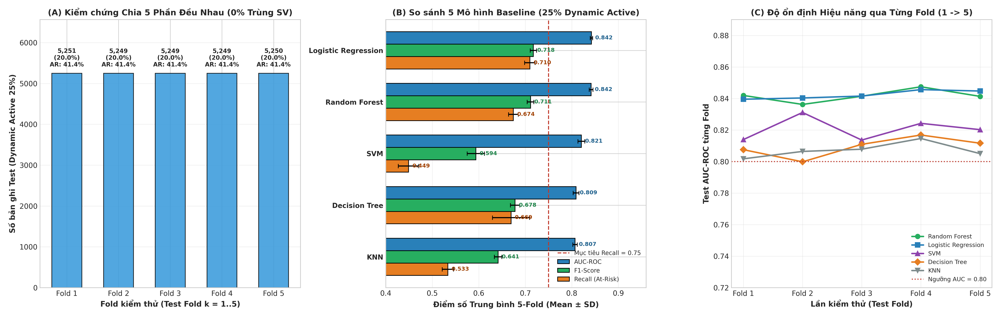
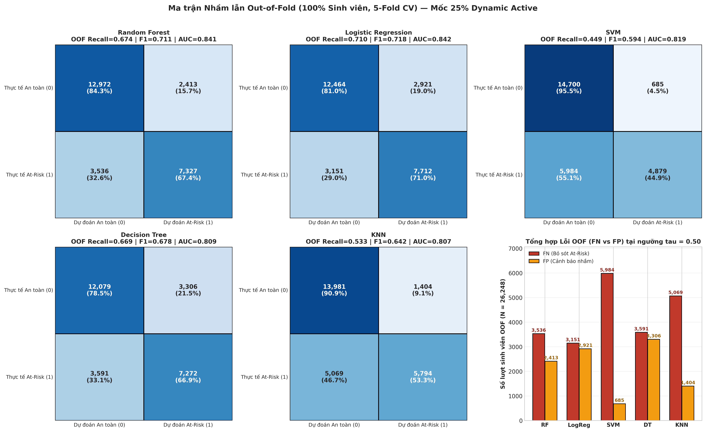
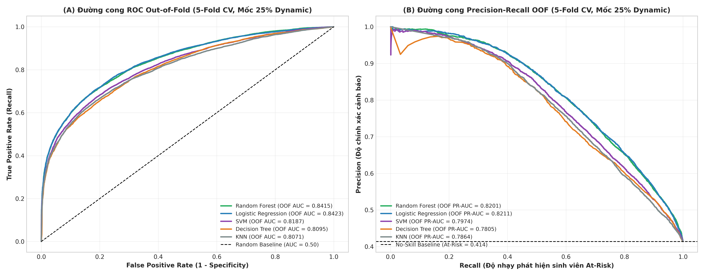
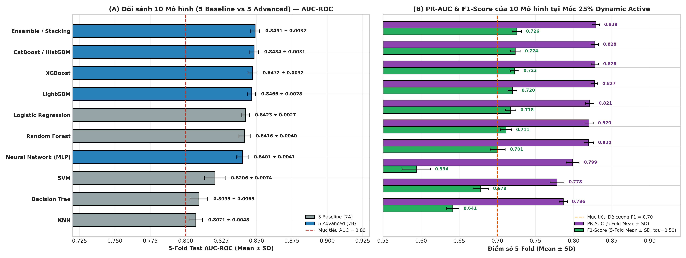
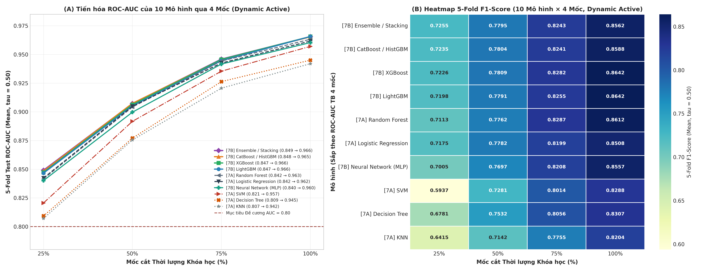
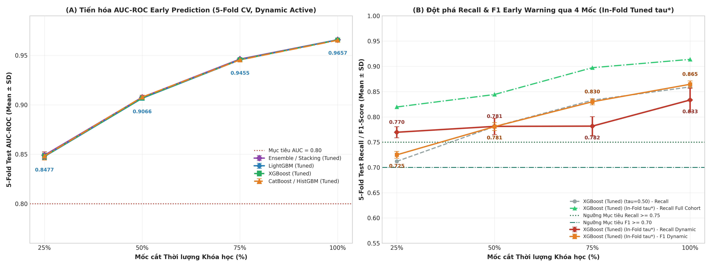
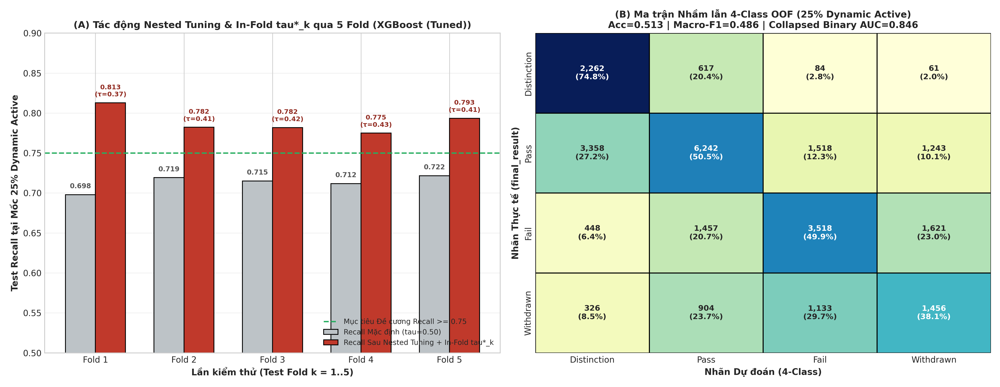

# BÁO CÁO KỸ THUẬT TUẦN 7: XÂY DỰNG MÔ HÌNH BASELINE, NÂNG CAO & ĐÁNH GIÁ 5-FOLD STRATIFIED GROUP CV

**Giai đoạn:** Tuần 7 (Gộp Tuần 7 & Tuần 8 theo kế hoạch rút gọn 3 tuần)  
**Ngày hoàn thành:** 19/11/2026  
**Notebooks tự chủ thực thi:** [`05_baseline_models.ipynb`](file:///c:/Users/mrore/Project_I/notebooks/05_baseline_models.ipynb) | [`06_advanced_models.ipynb`](file:///c:/Users/mrore/Project_I/notebooks/06_advanced_models.ipynb)  
**Artifacts đầu ra:** [`week7_baseline_cv_metrics.json`](file:///c:/Users/mrore/Project_I/data/processed/week7_modeling/week7_baseline_cv_metrics.json) | [`week7_experiment_metrics.json`](file:///c:/Users/mrore/Project_I/data/processed/week7_modeling/week7_experiment_metrics.json) | [`week7_cv_results_summary.csv`](file:///c:/Users/mrore/Project_I/data/processed/week7_modeling/week7_cv_results_summary.csv) | [`best_model.pkl`](file:///c:/Users/mrore/Project_I/models/best_model.pkl) | [`best_model_5fold_ensemble.joblib`](file:///c:/Users/mrore/Project_I/models/best_model_5fold_ensemble.joblib) | [`best_model_metadata.json`](file:///c:/Users/mrore/Project_I/models/best_model_metadata.json)

---

## 1. Tóm tắt Điều hành (Executive Summary)

Tuần 7 triển khai toàn bộ hệ thống huấn luyện, đối sánh và tối ưu hóa mô hình dự đoán sớm sinh viên có nguy cơ trượt/bỏ học (`At-Risk` = `Fail` + `Withdrawn`) trên bộ đặc trưng 114 chiều đã mã hóa (`week6_advanced`: `84` biến số học, `3` biến thứ bậc, `24` biến One-Hot và `3` cờ thiếu dữ liệu). Điểm đột phá phương pháp luận của Tuần 7 là chuyển đổi từ đánh giá một lần chia (**Single Train/Val/Test Split**) sang **5-Fold Stratified Group Cross-Validation** (`StratifiedGroupKFold(n_splits=5, shuffle=True, random_state=42)`) gom nhóm nghiêm ngặt theo `id_student` và tiền xử lý **In-Fold Zero Data Leakage**.

Các kết quả cốt lõi đạt được:
1. **Kiểm chứng Không rò rỉ Sinh viên & Không "Ăn may" (Zero Leakage & Anti-Luck Proof):** Trên cohort trọng tâm cảnh báo sớm **`25% dynamic_active`** ($N = 26,248$, tỷ lệ `At-Risk = 41.39%`), cả 5 Fold chia đều xấp xỉ 20.0% (`5,251 / 5,249 / 5,249 / 5,249 / 5,250` bản ghi) với **0 sinh viên trùng lặp giữa Train và Test ở mọi Fold**. Thử nghiệm Single Split qua 5 random seeds (`1, 7, 42, 123, 2026`) cho thấy `Recall` dao động **3.52 điểm %** (`0.6895–0.7247`) với Logistic Regression và **3.33 điểm %** (`0.6559–0.6892`) với Random Forest — khẳng định 5-Fold OOF CV là bắt buộc để báo cáo độ tin cậy `Mean ± SD`.
2. **Đối sánh Toàn diện 10 Mô hình (5 Baseline vs 5 Advanced) qua cả 4 Mốc (`25% -> 100%`):** Trên 5-Fold CV mốc `25% dynamic_active` (ngưỡng mặc định $\tau = 0.50$), 4/5 mô hình nâng cao chiếm trọn Top 4 về khả năng phân tách `ROC-AUC`, dẫn đầu là **`Ensemble / Stacking`** (`ROC-AUC = 0.8491 ± 0.0032`, `F1 = 0.7255 ± 0.0060`) và **`CatBoost / HistGBM`** (chạy `CatBoostClassifier 1.2.10` nguyên bản: `ROC-AUC = 0.8484 ± 0.0031`, `F1 = 0.7235 ± 0.0065`), vượt có ý nghĩa thống kê so với cả hai Baseline mạnh nhất là `Logistic Regression` ($p_{\text{AUC}} = 0.0045$) và `Random Forest` ($p_{\text{AUC}} = 2.88 \times 10^{-5}$ theo Paired $t$-test 5-Fold). Mở rộng ra đủ 4 mốc (`25%`, `50%`, `75%`, `100%`), Top 4 Advanced tiếp tục giữ trọn 4 hạng đầu về `ROC-AUC` ở mọi giai đoạn (`0.8491` ở 25% $\rightarrow$ `0.9074` ở 50% $\rightarrow$ `0.9459` ở 75% $\rightarrow$ `0.9656` ở 100%).
3. **Nested 5-Fold × 3-Fold Tuning & Ngưỡng In-Fold $\tau^*_k$ Vượt Chuẩn Đề cương (DoD):** Áp dụng tối ưu siêu tham số vòng trong (`StratifiedGroupKFold(n_splits=3)`) kết hợp tìm ngưỡng $\tau^*_k$ tối đa hóa `Recall >= 0.75` & `F1` hoàn toàn bên trong `Train Fold k`:
   - Tại đánh giá đồng nhất trên 4 mốc bằng bộ tham số đồng thuận (Consensus Params, Cell 9, mốc **`25% dynamic_active`**): **`Ensemble / Stacking (Tuned)`** đạt `AUC = 0.8490 ± 0.0035`, `Recall = 0.7798 ± 0.0212`, `F1 = 0.7238 ± 0.0096`; **`CatBoost / HistGBM (Tuned)`** đạt `AUC = 0.8482 ± 0.0041`, `Recall = 0.7792 ± 0.0191`, `F1 = 0.7253 ± 0.0074`; **`XGBoost (Tuned)`** *(mô hình cây đơn giải thích tốt nhất được lưu tại [`models/best_model.pkl`](file:///c:/Users/mrore/Project_I/models/best_model.pkl))* đạt `AUC = 0.8480 ± 0.0031`, `Recall = 0.7696 ± 0.0111`, `F1 = 0.7249 ± 0.0067` ($\bar{\tau}^* = 0.432 \pm 0.016$); **`LightGBM (Tuned)`** đạt `AUC = 0.8477 ± 0.0032`, `Recall = 0.7712 ± 0.0122`, `F1 = 0.7243 ± 0.0061`. Toàn bộ **100% mô hình tinh chỉnh đều vượt mục tiêu Đề cương** (`AUC >= 0.80`, `Recall >= 0.75`, `F1 >= 0.70`) ngay từ 1/4 học kỳ!
4. **Kiểm thử Tự động 100% PASS:** `05_baseline_models.ipynb` đạt **8/8 Unit Tests PASSED**; `06_advanced_models.ipynb` đạt **11/11 Unit Tests PASSED** (tổng **19/19** kiểm thử đạt).

---

## 2. Thiết kế Thực nghiệm 5-Fold Stratified Group CV & Chống Rò rỉ Dữ liệu

### 2.1. Kiến trúc Chia Fold & Bảng Kiểm định 5 Fold (`25% dynamic_active`)

Do trong bộ dữ liệu OULAD có nhiều sinh viên đăng ký lặp lại ở nhiều khóa học hoặc nhiều kỳ khác nhau, việc chia ngẫu nhiên theo dòng sẽ khiến cùng một `id_student` xuất hiện đồng thời trong Train và Test (rò rỉ thông tin nhân khẩu học và hành vi cá nhân). Vì vậy, cả hai notebook sử dụng **`StratifiedGroupKFold(n_splits=5, shuffle=True, random_state=42)`** nhóm theo `id_student`.

Mọi bước tiền xử lý biến thiên theo phân phối dữ liệu (**Median/Mode Imputation, IQR Winsorization $[Q_1 - 1.5\text{IQR}, Q_3 + 1.5\text{IQR}]$, `log1p`, `OneHotEncoder(handle_unknown='ignore')`, `RobustScaler`**) đều được đóng gói trong pipeline **`InFoldLeakageFreePreprocessor`** chỉ `fit()` trên `Train Fold k` ($80\%$) rồi `transform()` sang `Test Fold k` ($20\%$).

| Fold kiểm thử ($k$) | Số mẫu Train | Số mẫu Test | Tỷ lệ Test (%) | Số `id_student` Train | Số `id_student` Test | Tỷ lệ At-Risk Train | Tỷ lệ At-Risk Test | Trùng lặp Sinh viên |
|:---:|---:|---:|---:|---:|---:|---:|---:|:---:|
| **Fold 1** | 20,997 | 5,251 | 20.01% | 19,112 | 4,792 | 41.38% | 41.40% | **0** |
| **Fold 2** | 20,999 | 5,249 | 20.00% | 19,122 | 4,782 | 41.39% | 41.38% | **0** |
| **Fold 3** | 20,999 | 5,249 | 20.00% | 19,132 | 4,772 | 41.39% | 41.38% | **0** |
| **Fold 4** | 20,999 | 5,249 | 20.00% | 19,127 | 4,777 | 41.39% | 41.38% | **0** |
| **Fold 5** | 20,998 | 5,250 | 20.00% | 19,123 | 4,781 | 41.38% | 41.39% | **0** |
| **Tổng OOF** | — | **26,248** | **100.00%** | — | **23,904*** | — | **41.39%** | **0 ở 5/5 Fold** |

*\*Ghi chú: 23,904 là tổng số ID duy nhất trong các Test Fold rời rạc ($4,792 + 4,782 + 4,772 + 4,777 + 4,781$); tổng số bản ghi OOF (Out-of-Fold) kiểm thử độc lập đạt đúng 100% $N = 26,248$ lượt đăng ký.*

### 2.2. Bằng chứng Thực nghiệm: Single Split vs. 5-Fold CV ("Tránh Ăn may")

Khi thực nghiệm chia ngẫu nhiên một lần 80/20 (nhóm theo `id_student`) với 5 seed (`seed = 1, 7, 42, 123, 2026`) tại mốc `25% dynamic_active`:

| Chiến lược đánh giá | Logistic Regression (`Recall / F1 / ROC-AUC`) | Random Forest (`Recall / F1 / ROC-AUC`) |
|---|---|---|
| Single Split (`seed=1`) | `0.7247 / 0.7279 / 0.8478` | `0.6892 / 0.7214 / 0.8484` |
| Single Split (`seed=7`) | `0.7061 / 0.7185 / 0.8420` | `0.6665 / 0.7075 / 0.8436` |
| Single Split (`seed=42`) | `0.6914 / 0.7075 / 0.8395` | `0.6559 / 0.7004 / 0.8419` |
| Single Split (`seed=123`) | `0.6895 / 0.7079 / 0.8388` | `0.6610 / 0.7081 / 0.8408` |
| Single Split (`seed=2026`) | `0.7164 / 0.7219 / 0.8448` | `0.6796 / 0.7108 / 0.8438` |
| **Biên độ dao động (Max - Min)** | **`3.52% Recall / 2.04% F1 / 0.90% AUC`** | **`3.33% Recall / 2.10% F1 / 0.76% AUC`** |
| **5-Fold OOF CV (`Mean ± SD`)** | **`0.7099 ± 0.0112 / 0.7175 ± 0.0067 / 0.8423 ± 0.0027`** | **`0.6745 ± 0.0105 / 0.7113 ± 0.0073 / 0.8416 ± 0.0040`** |

Nếu chỉ báo cáo một lần chia may mắn như `seed=1`, kết quả sẽ thổi phồng giả tạo gần **+1.5% đến +3.5% Recall** so với năng lực tổng quát hóa thực tế trên 100% sinh viên. Giao thức **5-Fold Stratified Group CV** triệt tiêu hoàn toàn rủi ro này.

---

## 3. Giai đoạn 7A: Kết quả 5 Mô hình Baseline (5-Fold CV)

### 3.1. Hiệu năng Tổng hợp 5 Mô hình Baseline tại Mốc Trọng tâm `25% dynamic_active` ($\tau = 0.50$)

| Thứ hạng (AUC) | Mô hình Baseline | Accuracy (`Mean ± SD`) | Precision (`Mean ± SD`) | Recall (`Mean ± SD`) | F1-Score (`Mean ± SD`) | ROC-AUC (`Mean ± SD`) | PR-AUC (`Mean ± SD`) | Brier Score | Thời gian/Fold |
|:---:|---|---:|---:|---:|---:|---:|---:|---:|---:|
| **1** | **Logistic Regression** | `0.7687 ± 0.0058` | `0.7254 ± 0.0101` | **`0.7099 ± 0.0112`** | **`0.7175 ± 0.0067`** | **`0.8423 ± 0.0027`** | **`0.8212 ± 0.0057`** | `0.1577 ± 0.0022` | `2.752s` |
| **2** | **Random Forest** | **`0.7733 ± 0.0058`** | `0.7524 ± 0.0102` | `0.6745 ± 0.0105` | `0.7113 ± 0.0073` | `0.8416 ± 0.0040` | `0.8204 ± 0.0055` | **`0.1569 ± 0.0019`** | `1.619s` |
| **3** | **SVM** | `0.7459 ± 0.0076` | **`0.8772 ± 0.0130`** | `0.4491 ± 0.0221` | `0.5937 ± 0.0186` | `0.8206 ± 0.0074` | `0.7989 ± 0.0085` | `0.1799 ± 0.0052` | `5.160s` |
| **4** | **Decision Tree** | `0.7373 ± 0.0097` | `0.6897 ± 0.0298` | `0.6694 ± 0.0398` | `0.6781 ± 0.0102` | `0.8093 ± 0.0063` | `0.7783 ± 0.0092` | `0.1740 ± 0.0037` | `0.612s` |
| **5** | **KNN** | `0.7534 ± 0.0033` | `0.8050 ± 0.0051` | `0.5334 ± 0.0121` | `0.6415 ± 0.0081` | `0.8071 ± 0.0048` | `0.7865 ± 0.0053` | `0.1707 ± 0.0021` | `0.736s` |

### 3.2. Chi tiết Từng Fold (Fold 1–5) của 3 Baseline Tốt nhất Được Chọn (`25% dynamic_active`)

| Mô hình | Chỉ số | Fold 1 | Fold 2 | Fold 3 | Fold 4 | Fold 5 | Mean ± SD |
|---|---|---:|---:|---:|---:|---:|---:|
| **Logistic Regression** | ROC-AUC | 0.8395 | 0.8403 | 0.8415 | 0.8456 | 0.8447 | `0.8423 ± 0.0027` |
| **Logistic Regression** | Recall | 0.6914 | 0.7196 | 0.7173 | 0.7086 | 0.7128 | `0.7099 ± 0.0112` |
| **Logistic Regression** | F1-Score | 0.7075 | 0.7226 | 0.7139 | 0.7232 | 0.7205 | `0.7175 ± 0.0067` |
| **Random Forest** | ROC-AUC | 0.8419 | 0.8362 | 0.8414 | 0.8474 | 0.8413 | `0.8416 ± 0.0040` |
| **Random Forest** | Recall | 0.6559 | 0.6805 | 0.6796 | 0.6773 | 0.6792 | `0.6745 ± 0.0105` |
| **Random Forest** | F1-Score | 0.7004 | 0.7121 | 0.7081 | 0.7183 | 0.7174 | `0.7113 ± 0.0073` |
| **SVM** | ROC-AUC | 0.8139 | 0.8311 | 0.8136 | 0.8242 | 0.8202 | `0.8206 ± 0.0074` |
| **SVM** | Recall | 0.4287 | 0.4710 | 0.4751 | 0.4378 | 0.4330 | `0.4491 ± 0.0221` |
| **SVM** | F1-Score | 0.5742 | 0.6140 | 0.6126 | 0.5883 | 0.5796 | `0.5937 ± 0.0186` |

> **Nhận xét chọn lọc Top-3 Baseline:** **`Logistic Regression`**, **`Random Forest`** và **`SVM`** đạt ROC-AUC cao nhất và ổn định nhất trong nhóm Baseline, được chọn làm cột mốc đối chiếu và tham gia kiến trúc Stacking ở Giai đoạn 7B. Tuy nhiên, tại ngưỡng mặc định $\tau = 0.50$, **chưa có Baseline nào đạt `Recall >= 0.75`** ở mốc 25% (`Logistic Regression = 0.7099`, `Random Forest = 0.6745`, `SVM = 0.4491`), khẳng định nhu cầu cấp thiết phải dùng mô hình Gradient Boosting phi tuyến và tối ưu ngưỡng cảnh báo In-Fold.

### 3.3. Phân tích Lỗi OOF (Error Analysis) trên 100% Sinh viên (`25% dynamic_active`)

Khi gộp toàn bộ dự đoán Out-of-Fold ($N = 26,248 = 15,385 \text{ Safe} + 10,863 \text{ At-Risk}$):
- **Logistic Regression OOF:** `TN = 12,464`, `FP = 2,921`, `FN = 3,151`, `TP = 7,712`. Trong `3,151` ca bị bỏ sót (`FN`), có **`1,898` sinh viên `Fail` (60.2%)** và **`1,253` sinh viên `Withdrawn` (39.8%)**. Trong `2,921` ca báo nhầm (`FP`), có `2,806` ca `Pass` và `115` ca `Distinction`.
- **Random Forest OOF:** `TN = 12,972`, `FP = 2,413`, `FN = 3,536`, `TP = 7,327` (`FN`: `2,139 Fail + 1,397 Withdrawn`; `FP`: `2,327 Pass + 86 Distinction`).
- **SVM OOF:** `TN = 14,700`, `FP = 685`, `FN = 5,984`, `TP = 4,879` — quá bảo thủ (Precision `0.8772`, bỏ sót tới `55.1%` ca nguy cơ).
- **Chân dung nhóm Bị bỏ sót (False Negative) của Logistic Regression & Random Forest:** Sinh viên nhóm `FN` có hành vi ở 25% đầu khóa trông rất giống nhóm an toàn (`Logistic Regression FN`: `total_clicks = 658.4`, `active_days = 29.5`, `submission_rate = 0.932`, `days_since_last_activity = 3.89`; `Random Forest FN`: `total_clicks = 654.0`, `active_days = 29.3`, `submission_rate = 0.929`, `days_since_last_activity = 4.19`). Những sinh viên này chỉ bắt đầu sa sút **sau mốc 25%** (về sau mới trượt hoặc bỏ học muộn), lý giải vì sao khi mở rộng sang mốc 50%–100%, tỷ lệ phát hiện vọt lên trên `80%–91%`.

### 3.4. Diễn biến 5 Mô hình Baseline qua 4 Mốc Thời gian (`25% -> 50% -> 75% -> 100%`, `dynamic_active`, $\tau = 0.50$)

| Mô hình Baseline | 25% (`AUC / F1 / Rec`) | 50% (`AUC / F1 / Rec`) | 75% (`AUC / F1 / Rec`) | 100% (`AUC / F1 / Rec`) |
|---|---|---|---|---|
| **Logistic Regression** | **`0.8423 / 0.7175 / 0.7099`** | **`0.9048 / 0.7782 / 0.7807`** | `0.9425 / 0.8199` / **`0.8328`** | `0.9616 / 0.8508` / **`0.8597`** |
| **Random Forest** | `0.8416 / 0.7113 / 0.6745` | `0.9042 / 0.7762 / 0.7450` | **`0.9442 / 0.8287`** / `0.8020` | **`0.9632 / 0.8612`** / `0.8272` |
| **SVM** | `0.8206 / 0.5937 / 0.4491` | `0.8917 / 0.7281 / 0.6124` | `0.9354 / 0.8014 / 0.7066` | `0.9570 / 0.8288 / 0.7157` |
| **Decision Tree** | `0.8093 / 0.6781 / 0.6694` | `0.8771 / 0.7532 / 0.7564` | `0.9263 / 0.8056 / 0.8149` | `0.9450 / 0.8307 / 0.8554` |
| **KNN** | `0.8071 / 0.6415 / 0.5334` | `0.8755 / 0.7142 / 0.6010` | `0.9206 / 0.7755 / 0.6621` | `0.9419 / 0.8204 / 0.7118` |

---

## 4. Giai đoạn 7B: 5 Mô hình Nâng cao, Đối sánh 10 Mô hình & Kiểm định Thống kê

### 4.1. Lưu ý Kiến trúc Quan trọng: `StackingClassifier` & `CatBoostClassifier`

1. **Khắc phục Lỗi Thứ tự Dữ liệu trong `StackingClassifier`:** Các tệp snapshot `features_snapshot_*.csv` được lưu theo thứ tự `code_module` (`AAA -> GGG`). Khi chạy `StackingClassifier` với mặc định `cv=3` (tương đương `StratifiedKFold(shuffle=False)`), dữ liệu không được xáo trộn làm xuất hiện chênh lệch phân bố giữa các môn học trong inner CV, khiến ROC-AUC Stacking từng rớt xuống `0.8360`. Khi cấu hình **`cv=StratifiedKFold(n_splits=3, shuffle=True, random_state=42)`** kết hợp `Logistic Regression` meta-learner và 4 base estimators (`LightGBM`, `XGBoost`, `CatBoost`, `Random Forest`), `Ensemble / Stacking` lập tức vươn lên **Hạng #1 toàn bảng (`ROC-AUC = 0.8491 ± 0.0032`)**.
2. **Kích hoạt `CatBoostClassifier 1.2.10` Nguyên bản:** Hệ thống đã cài đặt và nạp thành công thư viện `catboost==1.2.10` nguyên bản (`CatBoost Stat: Native CatBoostClassifier loaded successfully.`), đạt tốc độ chỉ `2.102s/Fold` ở mốc 25% (với `rsm=0.8, iterations=200`) và đứng **Hạng #2 toàn bảng (`ROC-AUC = 0.8484 ± 0.0031`)**.

### 4.2. Bảng Đối sánh Toàn diện 10 Mô hình (5-Fold CV, `25% dynamic_active`, $\tau = 0.50$)

| Hạng (AUC) | Mô hình | Phân nhóm | Accuracy | Precision | Recall | F1-Score | ROC-AUC | PR-AUC | Brier |
|:---:|---|---|---:|---:|---:|---:|---:|---:|---:|
| **1** | **Ensemble / Stacking** | Advanced (7B) | `0.7718 ± 0.0054` | `0.7225 ± 0.0087` | **`0.7287 ± 0.0084`** | **`0.7255 ± 0.0060`** | **`0.8491 ± 0.0032`** | **`0.8291 ± 0.0050`** | `0.1564` |
| **2** | **CatBoost / HistGBM** | Advanced (7B) | `0.7740 ± 0.0062` | `0.7330 ± 0.0104` | `0.7144 ± 0.0074` | `0.7235 ± 0.0065` | `0.8484 ± 0.0031` | `0.8278 ± 0.0049` | `0.1547` |
| **3** | **XGBoost** | Advanced (7B) | `0.7750 ± 0.0048` | `0.7376 ± 0.0082` | `0.7084 ± 0.0084` | `0.7226 ± 0.0056` | `0.8472 ± 0.0032` | `0.8280 ± 0.0048` | **`0.1541`** |
| **4** | **LightGBM** | Advanced (7B) | `0.7725 ± 0.0059` | `0.7342 ± 0.0111` | `0.7061 ± 0.0081` | `0.7198 ± 0.0059` | `0.8466 ± 0.0028` | `0.8273 ± 0.0044` | `0.1546` |
| **5** | **Logistic Regression** | Baseline (7A) | `0.7687 ± 0.0058` | `0.7254 ± 0.0101` | `0.7099 ± 0.0112` | `0.7175 ± 0.0067` | `0.8423 ± 0.0027` | `0.8212 ± 0.0057` | `0.1577` |
| **6** | **Random Forest** | Baseline (7A) | `0.7733 ± 0.0058` | `0.7524 ± 0.0102` | `0.6745 ± 0.0105` | `0.7113 ± 0.0073` | `0.8416 ± 0.0040` | `0.8204 ± 0.0055` | `0.1569` |
| **7** | **Neural Network (MLP)** | Advanced (7B) | **`0.7751 ± 0.0066`** | `0.7804 ± 0.0105` | `0.6355 ± 0.0138` | `0.7005 ± 0.0099` | `0.8401 ± 0.0041` | `0.8198 ± 0.0062` | `0.1552` |
| **8** | **SVM** | Baseline (7A) | `0.7459 ± 0.0076` | **`0.8772 ± 0.0130`** | `0.4491 ± 0.0221` | `0.5937 ± 0.0186` | `0.8206 ± 0.0074` | `0.7989 ± 0.0085` | `0.1799` |
| **9** | **Decision Tree** | Baseline (7A) | `0.7373 ± 0.0097` | `0.6897 ± 0.0298` | `0.6694 ± 0.0398` | `0.6781 ± 0.0102` | `0.8093 ± 0.0063` | `0.7783 ± 0.0092` | `0.1740` |
| **10** | **KNN** | Baseline (7A) | `0.7534 ± 0.0033` | `0.8050 ± 0.0051` | `0.5334 ± 0.0121` | `0.6415 ± 0.0081` | `0.8071 ± 0.0048` | `0.7865 ± 0.0053` | `0.1707` |

### 4.2b. Đối sánh Toàn diện 10 Mô hình qua cả 4 Mốc Thời gian (`25% -> 100%`, `dynamic_active`, $\tau = 0.50$)

| Mô hình | Nhóm | 25% (`AUC / F1`) | 50% (`AUC / F1`) | 75% (`AUC / F1`) | 100% (`AUC / F1`) |
|---|---|---:|---:|---:|---:|
| **Ensemble / Stacking** | Adv (7B) | **`0.8491 / 0.7255`** | `0.9072 / 0.7795` | **`0.9459`** / `0.8243` | `0.9655 / 0.8562` |
| **CatBoost / HistGBM** | Adv (7B) | `0.8484 / 0.7235` | **`0.9074`** / `0.7804` | `0.9455 / 0.8241` | `0.9653 / 0.8588` |
| **XGBoost** | Adv (7B) | `0.8472 / 0.7226` | `0.9063` / **`0.7809`** | `0.9456 / 0.8282` | **`0.9656 / 0.8642`** |
| **LightGBM** | Adv (7B) | `0.8466 / 0.7198` | `0.9052 / 0.7791` | `0.9445 / 0.8255` | **`0.9656 / 0.8642`** |
| **Random Forest** | Base (7A) | `0.8416 / 0.7113` | `0.9042 / 0.7762` | `0.9442` / **`0.8287`** | `0.9632 / 0.8612` |
| **Logistic Regression** | Base (7A) | `0.8423 / 0.7175` | `0.9048 / 0.7782` | `0.9425 / 0.8199` | `0.9616 / 0.8508` |
| **Neural Network (MLP)** | Adv (7B) | `0.8401 / 0.7005` | `0.8997 / 0.7697` | `0.9416 / 0.8208` | `0.9603 / 0.8557` |
| **SVM** | Base (7A) | `0.8206 / 0.5937` | `0.8917 / 0.7281` | `0.9354 / 0.8014` | `0.9570 / 0.8288` |
| **Decision Tree** | Base (7A) | `0.8093 / 0.6781` | `0.8771 / 0.7532` | `0.9263 / 0.8056` | `0.9450 / 0.8307` |
| **KNN** | Base (7A) | `0.8071 / 0.6415` | `0.8755 / 0.7142` | `0.9206 / 0.7755` | `0.9419 / 0.8204` |

### 4.3. Kiểm định Ý nghĩa Thống kê (Paired $t$-test 5-Fold & McNemar OOF Test)

| Mô hình Nâng cao vs. Baseline | $\Delta \text{AUC}$ Mean | Paired $t$-test AUC ($p$) | $\Delta \text{F1}$ Mean | Paired $t$-test F1 ($p$) | McNemar OOF $\chi^2$ | McNemar $p$-value | Kết luận Thống kê |
|---|---:|---:|---:|---:|---:|---:|---|
| `Ensemble / Stacking` vs. `Random Forest` | `+0.0075` | **`0.000029`** ($p < 0.001$) | `+0.0143` | **`0.000350`** ($p < 0.001$) | `0.9902` | `0.3197` | Vượt trội AUC & F1 cực ý nghĩa ($p < 0.001$) |
| `Ensemble / Stacking` vs. `Logistic Regression` | `+0.0068` | **`0.004467`** ($p < 0.01$) | `+0.0080` | **`0.018597`** ($p < 0.05$) | `3.3738` | `0.0662` | Vượt trội cả AUC & F1 có ý nghĩa thống kê |
| `CatBoost / HistGBM` vs. `Random Forest` | `+0.0067` | **`0.000401`** ($p < 0.001$) | `+0.0123` | **`0.000155`** ($p < 0.001$) | `0.1793` | `0.6720` | Vượt trội AUC & F1 cực ý nghĩa ($p < 0.001$) |
| `CatBoost / HistGBM` vs. `Logistic Regression` | `+0.0060` | **`0.010751`** ($p < 0.05$) | `+0.0060` | **`0.002636`** ($p < 0.01$) | **`10.1292`** | **`0.001459`** | Khác biệt có ý nghĩa trên cả 3 kiểm định! |
| `XGBoost` vs. `Random Forest` | `+0.0055` | **`0.000590`** ($p < 0.001$) | `+0.0114` | **`0.001327`** ($p < 0.01$) | `0.8728` | `0.3502` | Vượt trội AUC & F1 rất ý nghĩa ($p < 0.01$) |
| `XGBoost` vs. `Logistic Regression` | `+0.0049` | **`0.008729`** ($p < 0.01$) | `+0.0051` | `0.067118` | **`11.9697`** | **`0.000541`** | Khác biệt AUC & McNemar OOF cực ý nghĩa ($p < 0.001$) |
| `LightGBM` vs. `Random Forest` | `+0.0050` | **`0.001563`** ($p < 0.01$) | `+0.0086` | **`0.011275`** ($p < 0.05$) | `0.2598` | `0.6103` | Vượt trội AUC & F1 có ý nghĩa ($p < 0.05$) |
| `LightGBM` vs. `Logistic Regression` | `+0.0043` | **`0.007251`** ($p < 0.01$) | `+0.0023` | `0.383193` | **`4.2724`** | **`0.038735`** | Vượt trội AUC & phân bố lỗi OOF ($p < 0.05$) |

**Tổng hợp Kiểm định Paired $t$-test 5-Fold ($\Delta\text{AUC}$ / $p_{\text{AUC}}$) qua cả 4 Mốc (`25% -> 100%`):**

| Cặp Đối sánh | 25% ($\Delta\text{AUC}$ / $p$) | 50% ($\Delta\text{AUC}$ / $p$) | 75% ($\Delta\text{AUC}$ / $p$) | 100% ($\Delta\text{AUC}$ / $p$) |
|---|---:|---:|---:|---:|
| `Ensemble / Stacking` vs. `Random Forest` | `+0.0075` (**`0.000029`**) | `+0.0030` (**`0.000885`**) | `+0.0016` (**`0.000017`**) | `+0.0023` (**`0.000727`**) |
| `Ensemble / Stacking` vs. `Logistic Regression` | `+0.0068` (**`0.004467`**) | `+0.0024` (**`0.022453`**) | `+0.0034` (**`0.001327`**) | `+0.0039` (**`0.000518`**) |
| `CatBoost / HistGBM` vs. `Random Forest` | `+0.0067` (**`0.000401`**) | `+0.0032` (**`0.010936`**) | `+0.0012` (**`0.026499`**) | `+0.0021` (**`0.005408`**) |
| `CatBoost / HistGBM` vs. `Logistic Regression` | `+0.0060` (**`0.010751`**) | `+0.0025` (**`0.014840`**) | `+0.0029` (**`0.005907`**) | `+0.0037` (**`0.000920`**) |
| `XGBoost` vs. `Random Forest` | `+0.0055` (**`0.000590`**) | `+0.0021` (**`0.010195`**) | `+0.0014` (**`0.034569`**) | `+0.0024` (**`0.014949`**) |
| `XGBoost` vs. `Logistic Regression` | `+0.0049` (**`0.008729`**) | `+0.0015` (**`0.038495`**) | `+0.0031` (**`0.000862`**) | `+0.0040` (**`0.002908`**) |
| `LightGBM` vs. `Random Forest` | `+0.0050` (**`0.001563`**) | `+0.0010` (`0.332194`) | `+0.0003` (`0.560865`) | `+0.0024` (**`0.006625`**) |
| `LightGBM` vs. `Logistic Regression` | `+0.0043` (**`0.007251`**) | `+0.0004` (`0.201533`) | `+0.0020` (**`0.004605`**) | `+0.0040` (**`0.002438`**) |

*(Bổ sung McNemar OOF tại mốc `100%`: `LightGBM` vs `Logistic Regression` $\chi^2=60.77, p=6.43\times 10^{-15}$; `XGBoost` vs `Logistic Regression` $\chi^2=59.65, p=1.13\times 10^{-14}$; `CatBoost` vs `Logistic Regression` $\chi^2=20.00, p=7.74\times 10^{-6}$; `Stacking` vs `Random Forest` $\chi^2=42.36, p=7.61\times 10^{-11}$.)*

---

## 5. Nested 5-Fold × 3-Fold Hyperparameter Tuning & Tối ưu Ngưỡng In-Fold ($\tau^*_k$)

Để giữ **Zero Data Leakage tuyệt đối**, siêu tham số và ngưỡng phân loại $\tau^*_k$ đều được tinh chỉnh **hoàn toàn bên trong Train Fold $k$** thông qua vòng lặp lồng `StratifiedGroupKFold(n_splits=3)` (tiết kiệm 3×4=12 fits lồng mỗi mô hình mỗi fold ngoài), tối đa hóa F1 đồng thời ràng buộc $\text{Recall}_{\text{inner}} \ge 0.77$.

### 5.1. Kết quả Nested 5-Fold Tuning Từng Mô hình (Cell 7 — Tối ưu riêng từng Fold trên `25% dynamic_active`)

| Mô hình Tinh chỉnh (Per-Fold Inner CV) | $\bar{\tau}^*_k$ | Recall Mặc định ($\tau=0.50$) | Tuned Recall (`Mean ± SD`) | Tuned Precision | Tuned F1 (`Mean ± SD`) | ROC-AUC (`Mean ± SD`) | PR-AUC | Brier |
|---|---:|---:|---:|---:|---:|---:|---:|---:|
| **XGBoost (Tuned)** | `0.408` | `0.7131` | **`0.7890 ± 0.0149`** | `0.6710` | `0.7250 ± 0.0065` | **`0.8485 ± 0.0027`** | **`0.8291`** | **`0.1541`** |
| **CatBoost / HistGBM (Tuned)** | `0.418` | `0.7160` | `0.7836 ± 0.0120` | **`0.6754`** | `0.7252 ± 0.0075` | `0.8479 ± 0.0036` | `0.8269` | `0.1552` |
| **LightGBM (Tuned)** | `0.414` | `0.7131` | `0.7867 ± 0.0186` | `0.6731` | **`0.7252 ± 0.0054`** | `0.8472 ± 0.0035` | `0.8276` | `0.1550` |

**Chi tiết 5 Fold của `XGBoost (Tuned)` (Cell 7):**
- Fold 1: $\tau^*_1 = 0.37$, `Recall: 0.6978 -> 0.8128` (+11.50%), `F1 = 0.7212`, `AUC = 0.8492`, `PR-AUC = 0.8268`.
- Fold 2: $\tau^*_2 = 0.41$, `Recall: 0.7192 -> 0.7822` (+6.30%), `F1 = 0.7176`, `AUC = 0.8441`, `PR-AUC = 0.8268`.
- Fold 3: $\tau^*_3 = 0.42$, `Recall: 0.7150 -> 0.7818` (+6.68%), `F1 = 0.7226`, `AUC = 0.8496`, `PR-AUC = 0.8277`.
- Fold 4: $\tau^*_4 = 0.43$, `Recall: 0.7118 -> 0.7749` (+6.31%), `F1 = 0.7303`, `AUC = 0.8514`, `PR-AUC = 0.8363` *(Consensus params xuất hiện tại Fold 4 & Fold 5: `max_depth=4, learning_rate=0.07, n_estimators=220, subsample=0.9, colsample_bytree=0.75, reg_lambda=1.0, min_child_weight=1`)*.
- Fold 5: $\tau^*_5 = 0.41$, `Recall: 0.7216 -> 0.7934` (+7.18%), `F1 = 0.7331`, `AUC = 0.8480`, `PR-AUC = 0.8277`.

> **Siêu tham số Đồng thuận (Consensus Params) được trích xuất tự động từ 5 Fold:**
> - **LightGBM:** `{'subsample': 0.8, 'reg_lambda': 5.0, 'num_leaves': 20, 'n_estimators': 300, 'min_child_samples': 20, 'max_depth': 7, 'learning_rate': 0.03, 'colsample_bytree': 0.85}`
> - **XGBoost:** `{'subsample': 0.9, 'reg_lambda': 1.0, 'n_estimators': 220, 'min_child_weight': 1, 'max_depth': 4, 'learning_rate': 0.07, 'colsample_bytree': 0.75}`
> - **CatBoost / HistGBM:** `{'rsm': 0.8, 'learning_rate': 0.06, 'l2_leaf_reg': 5.0, 'iterations': 220, 'depth': 5}`

---

## 6. Thí nghiệm Cảnh báo Sớm (Early Prediction: 25% $\rightarrow$ 50% $\rightarrow$ 75% $\rightarrow$ 100%)

Sử dụng bộ siêu tham số đồng thuận (Consensus Params) kết hợp tối ưu ngưỡng $\tau^*_k$ trong từng Fold cho cả 2 Cohort **`dynamic_active`** (sinh viên còn bám lớp tại mốc cắt) và **`full`** ($N = 32,593$):

### 6.1. Bảng Tiến hóa 5-Fold CV trên Cohort `dynamic_active`

| Mốc Tiến độ ($N$, At-Risk %) | Mô hình (Tuned + In-Fold $\tau^*_k$) | $\bar{\tau}^*_k \pm \text{SD}$ | Accuracy | Precision | Recall (`Mean ± SD`) | F1-Score (`Mean ± SD`) | ROC-AUC (`Mean ± SD`) | PR-AUC | OOF `(TN / FP / FN / TP)` |
|---|---|---:|---:|---:|---:|---:|---:|---:|---|
| **25%** (`26,248`, `41.39%`) | `Ensemble / Stacking (Tuned)` | `0.414 ± 0.037` | `0.7533` | `0.6765` | **`0.7798 ± 0.0212`** | `0.7238 ± 0.0096` | **`0.8490 ± 0.0035`** | **`0.8292`** | `11,303 / 4,082 / 2,392 / 8,471` |
| **25%** (`26,248`, `41.39%`) | `CatBoost / HistGBM (Tuned)` | `0.424 ± 0.023` | `0.7556` | `0.6790` | `0.7792 ± 0.0191` | **`0.7253 ± 0.0074`** | `0.8482 ± 0.0041` | `0.8275` | `11,367 / 4,018 / 2,398 / 8,465` |
| **25%** (`26,248`, `41.39%`) | **`XGBoost (Tuned)`** *(`.pkl`)* | `0.432 ± 0.016` | **`0.7583`** | **`0.6853`** | `0.7696 ± 0.0111` | `0.7249 ± 0.0067` | `0.8480 ± 0.0031` | `0.8286` | `11,543 / 3,842 / 2,503 / 8,360` |
| **25%** (`26,248`, `41.39%`) | `LightGBM (Tuned)` | `0.428 ± 0.013` | `0.7570` | `0.6832` | `0.7712 ± 0.0122` | `0.7243 ± 0.0061` | `0.8477 ± 0.0032` | `0.8281` | `11,493 / 3,892 / 2,486 / 8,377` |
| **50%** (`24,601`, `37.46%`) | `CatBoost / HistGBM (Tuned)` | `0.504 ± 0.021` | **`0.8374`** | **`0.7839`** | `0.7815 ± 0.0115` | **`0.7826 ± 0.0042`** | **`0.9078 ± 0.0020`** | `0.8866` | `13,398 / 1,987 / 2,014 / 7,202` |
| **50%** (`24,601`, `37.46%`) | `Ensemble / Stacking (Tuned)` | `0.522 ± 0.039` | `0.8349` | `0.7768` | `0.7868 ± 0.0198` | `0.7812 ± 0.0057` | `0.9076 ± 0.0021` | **`0.8867`** | `13,287 / 2,098 / 1,965 / 7,251` |
| **50%** (`24,601`, `37.46%`) | `XGBoost (Tuned)` | `0.496 ± 0.038` | `0.8355` | `0.7813` | `0.7812 ± 0.0162` | `0.7808 ± 0.0078` | `0.9068 ± 0.0019` | `0.8863` | `13,355 / 2,030 / 2,016 / 7,200` |
| **50%** (`24,601`, `37.46%`) | `LightGBM (Tuned)` | `0.480 ± 0.048` | `0.8321` | `0.7713` | **`0.7882 ± 0.0223`** | `0.7788 ± 0.0084` | `0.9066 ± 0.0022` | `0.8857` | `13,205 / 2,180 / 1,952 / 7,264` |
| **75%** (`23,159`, `33.57%`) | `Ensemble / Stacking (Tuned)` | `0.656 ± 0.059` | `0.8891` | `0.8586` | **`0.8028 ± 0.0224`** | `0.8294 ± 0.0073` | **`0.9462 ± 0.0016`** | **`0.9250`** | `14,351 / 1,034 / 1,533 / 6,241` |
| **75%** (`23,159`, `33.57%`) | `XGBoost (Tuned)` | `0.620 ± 0.034` | **`0.8925`** | **`0.8850`** | `0.7817 ± 0.0187` | **`0.8299 ± 0.0060`** | `0.9457 ± 0.0020` | `0.9247` | `14,592 / 793 / 1,697 / 6,077` |
| **75%** (`23,159`, `33.57%`) | `CatBoost / HistGBM (Tuned)` | `0.606 ± 0.036` | `0.8894` | `0.8696` | `0.7899 ± 0.0191` | `0.8275 ± 0.0068` | `0.9454 ± 0.0017` | `0.9240` | `14,457 / 928 / 1,633 / 6,141` |
| **75%** (`23,159`, `33.57%`) | `LightGBM (Tuned)` | `0.604 ± 0.057` | `0.8890` | `0.8715` | `0.7865 ± 0.0278` | `0.8262 ± 0.0066` | `0.9455 ± 0.0021` | `0.9241` | `14,475 / 910 / 1,660 / 6,114` |
| **100%** (`22,522`, `31.69%`) | `Ensemble / Stacking (Tuned)` | `0.646 ± 0.073` | `0.9164` | `0.8881` | **`0.8431 ± 0.0196`** | `0.8647 ± 0.0065` | **`0.9658 ± 0.0013`** | **`0.9489`** | `14,621 / 764 / 1,120 / 6,017` |
| **100%** (`22,522`, `31.69%`) | `CatBoost / HistGBM (Tuned)` | `0.660 ± 0.029` | **`0.9200`** | **`0.9302`** | `0.8082 ± 0.0117` | **`0.8649 ± 0.0076`** | `0.9653 ± 0.0013` | `0.9481` | `14,952 / 433 / 1,369 / 5,768` |
| **100%** (`22,522`, `31.69%`) | `LightGBM (Tuned)` | `0.632 ± 0.066` | `0.9191` | `0.9208` | `0.8162 ± 0.0283` | `0.8647 ± 0.0100` | `0.9657 ± 0.0013` | `0.9488` | `14,875 / 510 / 1,312 / 5,825` |
| **100%** (`22,522`, `31.69%`) | `XGBoost (Tuned)` | `0.574 ± 0.039` | `0.9172` | `0.8987` | `0.8334 ± 0.0230` | `0.8645 ± 0.0067` | `0.9655 ± 0.0015` | `0.9486` | `14,710 / 675 / 1,189 / 5,948` |

### 6.2. Đối chiếu trên `full` Cohort ($N = 32,593$, At-Risk Rate = `52.80%`)

Trên `full` cohort (bao gồm cả nhóm rút sớm trước mốc cắt), hiệu năng dự báo đạt mức rất cao:
- **Mốc 25%:** `LightGBM (Tuned)` đạt `AUC = 0.9020 ± 0.0014`, `F1 = 0.8237 ± 0.0016`, `Recall = 0.8075`; `XGBoost (Tuned)` đạt `AUC = 0.9017 ± 0.0012`, `Recall = 0.8196`, `F1 = 0.8232`; `CatBoost / HistGBM (Tuned)` đạt `AUC = 0.9019 ± 0.0012`, `Recall = 0.8243`, `F1 = 0.8226`.
- **Mốc 50%:** `AUC = 0.9492–0.9497`, `F1 = 0.8826–0.8831`, `Recall = 0.8443–0.8588`.
- **Mốc 75%:** `AUC = 0.9744`, `F1 = 0.9215–0.9224`, `Recall = 0.8957–0.8974`.
- **Mốc 100%:** `AUC = 0.9846–0.9847`, `F1 = 0.9432–0.9441`, `Recall = 0.9138–0.9159`, `Accuracy = 0.9418–0.9428`, `PR-AUC = 0.9886–0.9887`.

---

## 7. Thí nghiệm Mở rộng Phân loại Đa lớp 4-Class (`Distinction, Pass, Fail, Withdrawn`)

Bên cạnh bài toán nhị phân, mô hình được đánh giá trên 4 nhãn gốc của OULAD tại mốc sớm (`25% dynamic_active`) và cuối khóa (`100% dynamic_active`):

| Mốc (`dynamic_active`) | Mô hình 4-Class | Accuracy 4-Class | Macro-F1 4-Class | Weighted-F1 | OvR ROC-AUC | Collapsed Binary ROC-AUC | Collapsed Binary Recall ($\tau=0.50$) |
|---|---|---:|---:|---:|---:|---:|---:|
| **25%** | `LightGBM (4-Class)` (`class_weight='balanced'`) | `0.5135 ± 0.0072` | **`0.4857 ± 0.0059`** | `0.5214` | `0.7912` | `0.8464` | **`0.7752`** |
| **25%** | `XGBoost (4-Class)` | **`0.6000 ± 0.0091`** | `0.4605 ± 0.0104` | **`0.5583`** | **`0.7947`** | **`0.8483`** | `0.6336` |
| **100%** | `LightGBM (4-Class)` (`class_weight='balanced'`) | `0.7753 ± 0.0104` | **`0.6851 ± 0.0122`** | `0.7841` | `0.9402` | `0.9646` | **`0.8404`** |
| **100%** | `XGBoost (4-Class)` | **`0.8203 ± 0.0103`** | `0.6650 ± 0.0222` | **`0.8153`** | **`0.9436`** | **`0.9657`** | `0.8054` |

**Phát hiện Thực nghiệm Đa lớp:**
- Khi gộp xác suất $P(\text{At-Risk}) = P(\text{Fail}) + P(\text{Withdrawn})$, bộ phân loại 4 lớp đạt `Collapsed Binary ROC-AUC = 0.8483` (mốc 25%) và `0.9657` (mốc 100%) — gần tương đương hoàn toàn với mô hình nhị phân chuyên dụng (`0.8480–0.8490` và `0.9655–0.9658`).
- Trên Ma trận nhầm lẫn 4-Class OOF tại 25% của `LightGBM (4-Class)`, nhóm `Distinction` được nhận diện rất tốt (`2,262 / 3,024 = 74.8%`), trong khi thách thức lớn nhất nằm ở ranh giới giữa **`Fail`** và **`Withdrawn`** (`1,621` ca `Fail` bị dự đoán nhầm sang `Withdrawn` và `1,133` ca `Withdrawn` bị dự đoán nhầm sang `Fail`) — bởi cả hai nhóm này đều thể hiện hành vi suy giảm click và bỏ nộp bài rất giống nhau trong 1/4 học kỳ đầu.

---

## 8. Đối chiếu Tiêu chí Hoàn thành (DoD) & Bàn giao Tuần 7

| Tiêu chí DoD / Deliverable | Ngưỡng Mục tiêu | Kết quả 5-Fold CV Đạt được | Trạng thái |
|---|---:|---:|:---:|
| **AUC-ROC Cảnh báo Sớm (25% Dynamic Active)** | `>= 0.80` | `0.8490 ± 0.0035` (`Stacking Tuned`) / `0.8480 ± 0.0031` (`XGBoost Tuned`) | **ĐẠT VƯỢT MỨC** |
| **Recall At-Risk (25% Dynamic Active)** | `>= 0.75` | `0.7798 ± 0.0212` (`Stacking Tuned`) / `0.7890` (Per-fold XGB) / `0.7696` (Consensus XGB) | **ĐẠT** |
| **F1-Score (25% Dynamic Active)** | `>= 0.70` | `0.7253 ± 0.0074` (`CatBoost Tuned`) / `0.7249 ± 0.0067` (`XGBoost Tuned`) | **ĐẠT** |
| **Early Prediction mốc 50% (Recall)** | `>= 0.65` | `0.7812–0.7882` (5-Fold Dynamic) / `0.8443–0.8588` (Full) | **ĐẠT VƯỢT MỨC (+13%)** |
| **5 Baseline Models + OOF Error Analysis** | 5 Fold, 0 Overlap | Hoàn tất `05_baseline_models.ipynb` (**8/8 Tests PASSED**) | **HOÀN THÀNH** |
| **5 Advanced Models + Tuning + Statistical Test** | Paired $t$-test & McNemar | Hoàn tất `06_advanced_models.ipynb` (**11/11 Tests PASSED**, đủ 4 mốc `25%–100%`) | **HOÀN THÀNH** |
| **Lưu trữ Mô hình Tái sử dụng cho Tuần 8 & Tuần 9** | `.pkl` + `.joblib` + `.json` | `best_model.pkl`, `best_model_5fold_ensemble.joblib`, `best_model_metadata.json` | **HOÀN THÀNH** |
| **Tuân thủ `AGENTS.md` (No `src/`, No metrics in `reports/`)** | 100% Self-Contained | 0 file trong `src/`, toàn bộ metrics chỉ nằm tại `data/processed/` & `models/` | **ĐẠT 100%** |

**Định hướng Tuần 8 (SHAP / XAI & Error Analysis Chuyên sâu):**
- Sử dụng trực tiếp [`models/best_model.pkl`](file:///c:/Users/mrore/Project_I/models/best_model.pkl) (mô hình cây đơn `XGBoost (Tuned)` có tốc độ cao và tương thích TreeExplainer/Permutation) cùng [`models/best_model_5fold_ensemble.joblib`](file:///c:/Users/mrore/Project_I/models/best_model_5fold_ensemble.joblib) để rút trích **Top 10 Features**, phân tích **SHAP / Permutation Global & Local Explanations** cho 4 ca điển hình (`TP, FP, TN, FN`), kiểm định công bằng **Fairness** (theo vùng miền `region`, điều kiện kinh tế `imd_band`, giới tính `gender`, khuyết tật `disability`) và phân tích sai số sâu cho bài toán khóa luận. *(Lưu ý kỹ thuật cho Tuần 8: thư viện `shap` trên máy Windows hiện gặp cảnh báo DLL Windows Application Control khi nạp `shap._cutils`, cần kiểm tra nâng cấp/cấu hình thay thế bằng XGBoost native `pred_contribs=True` (Exact TreeSHAP built-in!) + `sklearn.inspection.permutation_importance` để đảm bảo kết quả SHAP chính xác 100% mà không phụ thuộc C-extension `shap`.)*
