# BÁO CÁO KỸ THUẬT TUẦN 8: GIẢI THÍCH MÔ HÌNH ĐA MỐC (EXPLAINABLE AI), KHUNG SEDL, KIỂM ĐỊNH CÔNG BẰNG & ỨNG DỤNG DEMO

**Giai đoạn:** Tuần 8 (Gộp Tuần 9 & Tuần 10 theo kế hoạch rút gọn)  
**Ngày hoàn thành:** 25/11/2026  
**Tác giả thực hiện:** Vũ Hoà Bình (MSSV: `202416137`)  
**Notebooks & Ứng dụng tự chủ:** [`07_model_explanation.ipynb`](file:///c:/Users/mrore/Project_I/notebooks/07_model_explanation.ipynb) | [`demo/app.py`](file:///c:/Users/mrore/Project_I/demo/app.py) | [`README.md`](file:///c:/Users/mrore/Project_I/README.md) | [`requirements.txt`](file:///c:/Users/mrore/Project_I/requirements.txt)  
**Artifacts đầu ra:** [`week8_xai_metrics.json`](file:///c:/Users/mrore/Project_I/data/processed/week8_xai/week8_xai_metrics.json) | [`top_features_consensus_week8.csv`](file:///c:/Users/mrore/Project_I/data/processed/week8_xai/top_features_consensus_week8.csv) | [`top_features_consensus_4milestones_week8.csv`](file:///c:/Users/mrore/Project_I/data/processed/week8_xai/top_features_consensus_4milestones_week8.csv) | [`case_studies_week8.json`](file:///c:/Users/mrore/Project_I/data/processed/week8_xai/case_studies_week8.json) | [`fairness_audit_week8.csv`](file:///c:/Users/mrore/Project_I/data/processed/week8_xai/fairness_audit_week8.csv) | [`demo_oof_all_milestones_summary.csv`](file:///c:/Users/mrore/Project_I/data/processed/week8_xai/demo_oof_all_milestones_summary.csv)

---

## 1. Tóm tắt Điều hành (Executive Summary)

Tuần 8 hoàn thiện bước chuyển hóa từ mô hình dự báo chính xác sang **hệ thống hỗ trợ ra quyết định sư phạm minh bạch, công bằng và có thể vận hành thực tế** trên **toàn bộ 4 lát cắt tiến độ học tập (`25%, 50%, 75%, 100% dynamic_active`)**. Trên nền tảng mô hình **`XGBoost (Tuned)`** (gói 5-Fold 4 mốc [`models/best_model_5fold_4milestones.joblib`](file:///c:/Users/mrore/Project_I/models/best_model_5fold_4milestones.joblib), tương thích ngược với [`models/best_model.pkl`](file:///c:/Users/mrore/Project_I/models/best_model.pkl) và [`models/best_model_5fold_ensemble.joblib`](file:///c:/Users/mrore/Project_I/models/best_model_5fold_ensemble.joblib)) với $114$ chiều đặc trưng đã mã hóa, đề tài đã triển khai đồng bộ **5 kỹ thuật Explainable AI (XAI)**, **Kiểm định Công bằng Nhân khẩu học đa mốc** và **Ứng dụng Demo Streamlit 5 Tab**:

1. **Tái lập chính xác 5-Fold Out-of-Fold & Exact TreeSHAP qua cả 4 mốc (`max error <= 4.42e-07`):** Toàn bộ $96{,}530$ lượt dự đoán OOF qua 4 mốc (`25%`: $N=26{,}248$; `50%`: $N=24{,}601$; `75%`: $N=23{,}159$; `100%`: $N=22{,}522$) được giải thích chuẩn xác trên từng Fold kiểm thử độc lập (**Zero Data Leakage**) bằng động cơ **Exact TreeSHAP** (`pred_contribs=True`) `[Lundberg et al., 2020]`. Hiệu năng `ROC-AUC` tăng đều `0.8480 → 0.9068 → 0.9457 → 0.9655`, `Recall` đạt `0.7696 → 0.7813 → 0.7817 → 0.8334`, `F1` đạt `0.7249 → 0.7808 → 0.8299 → 0.8645`, với sai số cộng tính Shapley tối đa ở từng mốc lần lượt là `3.32e-07`, `4.03e-07`, `4.42e-07` và `3.58e-07`.
2. **Đồng thuận Toàn cục & Tiến hóa Top 10 Đặc trưng Quyết định (`25% -> 100%`):** Ba phương pháp đánh giá toàn cục (`Exact TreeSHAP Mean |φ|`, `5-Fold Permutation Importance`, `XGBoost Built-in Gain`) đạt độ nhất quán xếp hạng cao qua cả 4 mốc ($\rho(\text{SHAP, Perm}) = 0.8296, 0.7280, 0.7410, 0.7849$). Trục dẫn dắt dịch chuyển rõ nét từ điểm số sớm tại `25%` (`weighted_avg_score` `13.12%`, `avg_score` `11.36%`) sang tỷ lệ nộp bài tại `50%` (`submission_rate` `18.47%`), cân bằng điểm số -- vắng mặt tại `75%` (`weighted_avg_score` `16.20%`, `days_since_last_activity` `13.10%`, `submission_rate` `12.97%`), và chuỗi ngưng tương tác dài nhất tại `100%` (`max_inactivity_streak` `12.94%`).
3. **Beeswarm 4 Mốc & Dịch chuyển Khung Lý thuyết SEDL (`25% -> 100%`):** Khi ánh xạ 114 đặc trưng về **4 chiều SEDL** `[Bergdahl et al., 2024]` (`42 Behavioural`, `29 Cognitive`, `8 Social`, `35 Demographic & Context`), tỷ trọng **`Demographic & Context`** giảm gần 3 lần từ **`21.02%`** (25%) xuống **`12.70%`** (50%), **`8.98%`** (75%) và **`7.84%`** (100%), nhường chỗ cho **`Behavioural`** vọt từ **`40.82%`** lên **`59.38%`**, trong khi **`Cognitive`** giữ vai trò trụ cột **`36.08% → 30.51%`** và **`Social`** đóng góp **`2.08% → 3.13% → 2.27%`**.
4. **Ngưỡng Phi tuyến (PDP/ICE) & Giải thích Cục bộ Đa mốc (16 Case Studies + LIME 800 OOF):** Phân tích PDP/ICE và SHAP Dependence cho 5 đặc trưng chủ chốt xác định các ngưỡng bất biến (`weighted_avg_score` uốn `42.5–47.5`, $\phi=0$ quanh `63.1–69.2`; `consistency_score` $\phi=0$ quanh `0.79–0.82`) và các ngưỡng vắng mặt dịch chuyển theo tiến độ (`days_since_last_activity` $\phi=0$: `7.60 → 15.90 → 28.97 → 38.79` ngày). Trên 16 Case Studies (`TP/FP/TN/FN` $\times$ 4 mốc), quỹ đạo dọc thời gian của SV `#2137413` (`EEE-2013J`) và 200 sinh viên OOF/mốc ($800$ lượt), `Local Surrogate LIME` `[Ribeiro et al., 2016]` đạt độ trung thực ổn định **`R² = 0.6755 / 0.6764 / 0.6744 / 0.6939`** và Top-10 Overlap tăng `50.40% → 56.45%`.
5. **Kiểm định Công bằng Đa mốc (`25% -> 100%`) & Demo Đa mốc:** Từ `25%` đến `100%`, khoảng cách Equal Opportunity ($\Delta\text{TPR}$) giảm mạnh ở mọi thuộc tính: `disability` (`0.0701 → 0.0014`, đạt quy tắc 4/5 tại `100%`), `age_band` (`0.1795 → 0.0475`), `imd_band` (`0.2543 → 0.1219`), `gender` (đạt 4/5 ở cả 4 mốc: `0.0614 → 0.0457`), và `region` ($\Delta\text{AUC} \le 0.0413$). Hệ thống [`07_model_explanation.ipynb`](file:///c:/Users/mrore/Project_I/notebooks/07_model_explanation.ipynb) đạt **12/12 Unit Tests PASSED**.

---

## 2. Tái lập Thực nghiệm OOF 5-Fold & Cơ chế Exact TreeSHAP qua 4 Mốc

### 2.1. Kiểm chứng Hiệu năng 5-Fold Out-of-Fold (`25%, 50%, 75%, 100% dynamic_active`)

Notebook [`07_model_explanation.ipynb`](file:///c:/Users/mrore/Project_I/notebooks/07_model_explanation.ipynb) nạp và kiểm chứng đồng bộ 5 mô hình theo từng phân vùng (`fold_models`), 5 bộ tiền xử lý (`fold_preprocessors`) và 5 ngưỡng tối ưu nội bộ $\tau^*_k$ cho cả 4 mốc thời gian trong [`models/best_model_5fold_4milestones.joblib`](file:///c:/Users/mrore/Project_I/models/best_model_5fold_4milestones.joblib) để bảo đảm **0% Data Leakage** `[Kaufman et al., 2012]`.

| Mốc (`dynamic_active`) | Số mẫu ($N$) | Tỷ lệ At-Risk | $\bar{\tau}^*_k$ | ROC-AUC | PR-AUC | Recall | Precision | F1-Score | Accuracy | Brier Score | Max SHAP Err | Ma trận Nhầm lẫn OOF (`TN / FP / FN / TP`) |
|:---:|---:|---:|---:|---:|---:|---:|---:|---:|---:|---:|---:|---|
| **25%** | 26,248 | 41.39% | 0.432 | 0.8480 | 0.8286 | 0.7696 | 0.6853 | 0.7249 | 0.7583 | 0.1544 | `3.32e-07` | `11,543 / 3,842 / 2,503 / 8,360` |
| **50%** | 24,601 | 37.46% | 0.496 | 0.9068 | 0.8863 | 0.7813 | 0.7813 | 0.7808 | 0.8355 | 0.1158 | `4.03e-07` | `13,355 / 2,030 / 2,016 / 7,200` |
| **75%** | 23,159 | 33.57% | 0.620 | 0.9457 | 0.9246 | 0.7817 | 0.8850 | 0.8299 | 0.8925 | 0.0839 | `4.42e-07` | `14,592 / 793 / 1,697 / 6,077` |
| **100%** | 22,522 | 31.69% | 0.574 | **0.9655** | **0.9486** | **0.8334** | **0.8987** | **0.8645** | **0.9172** | **0.0633** | `3.58e-07` | `14,710 / 675 / 1,189 / 5,948` |

Chi tiết từng phân vùng (Fold 1--5) cho từng mốc:
- **Mốc 25%:** Fold 1 ($\tau^*_1=0.42$, AUC `0.8497`, Rec `0.7700`, F1 `0.7225`, Err `2.71e-07`), Fold 2 ($\tau^*_2=0.44$, AUC `0.8430`, Rec `0.7624`, F1 `0.7222`, Err `3.32e-07`), Fold 3 ($\tau^*_3=0.44$, AUC `0.8482`, Rec `0.7624`, F1 `0.7167`, Err `2.77e-07`), Fold 4 ($\tau^*_4=0.41$, AUC `0.8514`, Rec `0.7887`, F1 `0.7294`, Err `3.14e-07`), Fold 5 ($\tau^*_5=0.45$, AUC `0.8476`, Rec `0.7644`, F1 `0.7338`, Err `3.26e-07`).
- **Mốc 50%:** Fold 1 ($\tau^*_1=0.43$, AUC `0.9035`, Rec `0.8095`, F1 `0.7715`, Err `2.87e-07`), Fold 2 ($\tau^*_2=0.51$, AUC `0.9079`, Rec `0.7711`, F1 `0.7833`, Err `2.61e-07`), Fold 3 ($\tau^*_3=0.51$, AUC `0.9070`, Rec `0.7721`, F1 `0.7738`, Err `2.42e-07`), Fold 4 ($\tau^*_4=0.50$, AUC `0.9074`, Rec `0.7802`, F1 `0.7858`, Err `2.88e-07`), Fold 5 ($\tau^*_5=0.53$, AUC `0.9083`, Rec `0.7732`, F1 `0.7897`, Err `4.03e-07`).
- **Mốc 75%:** Fold 1 ($\tau^*_1=0.63$, AUC `0.9438`, Rec `0.7749`, F1 `0.8325`, Err `3.16e-07`), Fold 2 ($\tau^*_2=0.66$, AUC `0.9448`, Rec `0.7606`, F1 `0.8246`, Err `2.38e-07`), Fold 3 ($\tau^*_3=0.64$, AUC `0.9447`, Rec `0.7711`, F1 `0.8243`, Err `3.06e-07`), Fold 4 ($\tau^*_4=0.58$, AUC `0.9461`, Rec `0.7961`, F1 `0.8295`, Err `4.42e-07`), Fold 5 ($\tau^*_5=0.59$, AUC `0.9489`, Rec `0.8058`, F1 `0.8387`, Err `2.77e-07`).
- **Mốc 100%:** Fold 1 ($\tau^*_1=0.61$, AUC `0.9663`, Rec `0.8255`, F1 `0.8681`, Err `2.87e-07`), Fold 2 ($\tau^*_2=0.56$, AUC `0.9658`, Rec `0.8242`, F1 `0.8639`, Err `2.28e-07`), Fold 3 ($\tau^*_3=0.55$, AUC `0.9672`, Rec `0.8564`, F1 `0.8711`, Err `3.04e-07`), Fold 4 ($\tau^*_4=0.62$, AUC `0.9648`, Rec `0.8038`, F1 `0.8534`, Err `3.58e-07`), Fold 5 ($\tau^*_5=0.53$, AUC `0.9633`, Rec `0.8570`, F1 `0.8658`, Err `3.23e-07`).

### 2.2. Bảo đảm Tính chính xác Toán học của Exact TreeSHAP

Giá trị Shapley $\phi_i(x)$ được tính trong không gian log-odds bằng động cơ TreeSHAP tích hợp sẵn trong nhân C++ của XGBoost (`pred_contribs=True`), thỏa mãn tiên đề cộng tính địa phương `[Lundberg et al., 2017; Lundberg et al., 2020]`: $f(x) = \phi_0 + \sum_{i=1}^{114} \phi_i(x)$ và $\widehat{P}(\text{At-Risk}\mid x) = \sigma(f(x))$. Sai số tái lập tối đa qua toàn bộ 20 phân vùng kiểm thử ($96{,}530$ lượt OOF trên cả 4 mốc) đều $\le 4.42 \times 10^{-7}$.

---

## 3. Giải thích Toàn cục (Global XAI) & Tiến hóa Top 10 Đặc trưng Đồng thuận qua 4 Mốc

### 3.1. So sánh Độ nhất quán 3 Phương pháp Toàn cục qua 4 Mốc (`25% -> 100%`)

Nghiên cứu đối chiếu ba phương pháp đánh giá tầm quan trọng toàn cục bổ trợ lẫn nhau trên tất cả 114 đặc trưng tại từng mốc: **Exact TreeSHAP Mean $|\phi_i|$**, **5-Fold OOF Permutation Importance** (`scoring='roc_auc'`, `n_repeats=5` trên Test Fold $k$) `[Breiman, 2001]` và **XGBoost Built-in Gain** `[Chen & Guestrin, 2016]`.

| Mốc | Số mẫu OOF | Spearman $\rho(\text{SHAP, Perm})$ | Spearman $\rho(\text{SHAP, Gain})$ | Spearman $\rho(\text{Perm, Gain})$ | Tổng điểm Đồng thuận Top 10 |
|:---:|---:|---:|---:|---:|---:|
| **25%** | 26,248 | **0.8296** | 0.7810 | 0.7027 | 56.56% |
| **50%** | 24,601 | 0.7280 | 0.7134 | 0.5943 | 62.78% |
| **75%** | 23,159 | 0.7410 | 0.7374 | 0.6581 | 70.27% |
| **100%** | 22,522 | 0.7849 | **0.7991** | **0.7281** | **70.94%** |

Công thức tổng hợp: $\text{Consensus Score (\%)} = 0.45 \times \text{SHAP}_{\text{share}} + 0.35 \times \text{Perm}_{\text{share}} + 0.20 \times \text{Gain}_{\text{share}}$.

### 3.2. Bảng Top 10 Đặc trưng Đồng thuận qua Cả 4 Mốc Thời gian

| Mốc | Hạng | Đặc trưng (`feature_name`) | Chiều SEDL | Đồng thuận (%) | Exact TreeSHAP $|\phi|$ (% / #) | 5-Fold Perm $\Delta$AUC (% / #) | XGBoost Gain (% / #) |
|:---:|:---:|---|---|---:|---:|---:|---:|
| **25%** | 1 | `weighted_avg_score` | Cognitive | **13.12%** | 0.3669 (`9.68%`, #1) | 0.0202 (`19.01%`, #1) | 243.37 (`10.55%`, #1) |
| **25%** | 2 | `avg_score` | Cognitive | **11.36%** | 0.3195 (`8.43%`, #2) | 0.0185 (`17.38%`, #2) | 170.34 (`7.39%`, #3) |
| **25%** | 3 | `course_progress_submission_rate` | Behavioural | **5.60%** | 0.1747 (`4.61%`, #5) | 0.0091 (`8.57%`, #3) | 60.71 (`2.63%`, #6) |
| **25%** | 4 | `submission_rate` | Behavioural | **4.63%** | 0.1795 (`4.74%`, #4) | 0.0051 (`4.81%`, #6) | 93.77 (`4.07%`, #5) |
| **25%** | 5 | `code_module_GGG` | Demog. & Context | **4.50%** | 0.1386 (`3.66%`, #8) | 0.0076 (`7.19%`, #4) | 39.16 (`1.70%`, #12) |
| **25%** | 6 | `highest_education` | Demog. & Context | **4.31%** | 0.1829 (`4.83%`, #3) | 0.0057 (`5.33%`, #5) | 32.14 (`1.39%`, #15) |
| **25%** | 7 | `days_since_last_activity` | Behavioural | **3.71%** | 0.1598 (`4.22%`, #6) | 0.0043 (`4.02%`, #7) | 46.59 (`2.02%`, #8) |
| **25%** | 8 | `consistency_score` | Behavioural | **3.52%** | 0.1524 (`4.02%`, #7) | 0.0041 (`3.90%`, #8) | 39.56 (`1.72%`, #11) |
| **25%** | 9 | `avg_days_before_deadline` | Behavioural | **2.99%** | 0.1229 (`3.24%`, #9) | 0.0040 (`3.80%`, #9) | 22.40 (`0.97%`, #23) |
| **25%** | 10 | `active_weeks` | Behavioural | **2.82%** | 0.0896 (`2.36%`, #11) | 0.0005 (`0.50%`, #28) | 182.68 (`7.92%`, #2) |
| **50%** | 1 | `submission_rate` | Behavioural | **18.47%** | 0.6535 (`14.11%`, #1) | 0.0213 (`23.30%`, #2) | 496.71 (`19.83%`, #1) |
| **50%** | 2 | `weighted_avg_score` | Cognitive | **13.73%** | 0.4108 (`8.87%`, #2) | 0.0230 (`25.15%`, #1) | 116.73 (`4.66%`, #4) |
| **50%** | 3 | `earned_weight_score` | Cognitive | **6.99%** | 0.2914 (`6.29%`, #4) | 0.0102 (`11.19%`, #3) | 30.27 (`1.21%`, #13) |
| **50%** | 4 | `days_since_last_activity` | Behavioural | **6.22%** | 0.3136 (`6.77%`, #3) | 0.0055 (`5.99%`, #4) | 134.67 (`5.38%`, #3) |
| **50%** | 5 | `engagement_decay` | Behavioural | **4.02%** | 0.2014 (`4.35%`, #5) | 0.0022 (`2.43%`, #7) | 152.36 (`6.08%`, #2) |
| **50%** | 6 | `avg_score` | Cognitive | **3.77%** | 0.1841 (`3.98%`, #6) | 0.0034 (`3.76%`, #5) | 83.26 (`3.32%`, #7) |
| **50%** | 7 | `clicks_trend` | Behavioural | **2.62%** | 0.1432 (`3.09%`, #8) | 0.0029 (`3.17%`, #6) | 15.05 (`0.60%`, #31) |
| **50%** | 8 | `clicks_last_2_weeks` | Behavioural | **2.62%** | 0.1472 (`3.18%`, #7) | 0.0014 (`1.48%`, #14) | 83.54 (`3.34%`, #6) |
| **50%** | 9 | `max_inactivity_streak` | Behavioural | **2.20%** | 0.1318 (`2.85%`, #10) | 0.0020 (`2.14%`, #8) | 21.21 (`0.85%`, #23) |
| **50%** | 10 | `highest_education` | Demog. & Context | **2.13%** | 0.1382 (`2.98%`, #9) | 0.0016 (`1.74%`, #12) | 22.77 (`0.91%`, #20) |
| **75%** | 1 | `weighted_avg_score` | Cognitive | **16.20%** | 0.4934 (`8.98%`, #3) | 0.0239 (`31.90%`, #1) | 129.37 (`4.97%`, #4) |
| **75%** | 2 | `days_since_last_activity` | Behavioural | **13.10%** | 0.6591 (`12.00%`, #1) | 0.0117 (`15.61%`, #2) | 291.14 (`11.19%`, #2) |
| **75%** | 3 | `submission_rate` | Behavioural | **12.97%** | 0.6136 (`11.17%`, #2) | 0.0081 (`10.77%`, #4) | 543.61 (`20.89%`, #1) |
| **75%** | 4 | `earned_weight_score` | Cognitive | **9.34%** | 0.4681 (`8.52%`, #4) | 0.0102 (`13.62%`, #3) | 95.84 (`3.68%`, #5) |
| **75%** | 5 | `course_progress_submission_rate` | Behavioural | **4.37%** | 0.2772 (`5.05%`, #5) | 0.0034 (`4.48%`, #5) | 69.54 (`2.67%`, #7) |
| **75%** | 6 | `engagement_decay` | Behavioural | **3.81%** | 0.2253 (`4.10%`, #6) | 0.0020 (`2.66%`, #8) | 134.17 (`5.16%`, #3) |
| **75%** | 7 | `avg_score` | Cognitive | **3.19%** | 0.1845 (`3.36%`, #9) | 0.0023 (`3.12%`, #7) | 76.60 (`2.94%`, #6) |
| **75%** | 8 | `clicks_trend` | Behavioural | **2.95%** | 0.1928 (`3.51%`, #8) | 0.0027 (`3.54%`, #6) | 16.44 (`0.63%`, #20) |
| **75%** | 9 | `max_inactivity_streak` | Behavioural | **2.91%** | 0.2243 (`4.08%`, #7) | 0.0016 (`2.21%`, #9) | 39.50 (`1.52%`, #9) |
| **75%** | 10 | `highest_education` | Demog. & Context | **1.42%** | 0.1167 (`2.12%`, #10) | 0.0007 (`0.91%`, #12) | 19.12 (`0.73%`, #19) |
| **100%** | 1 | `max_inactivity_streak` | Behavioural | **12.94%** | 0.7427 (`11.48%`, #1) | 0.0083 (`12.18%`, #4) | 537.21 (`17.57%`, #2) |
| **100%** | 2 | `submission_rate` | Behavioural | **11.60%** | 0.6289 (`9.72%`, #3) | 0.0121 (`17.81%`, #1) | 151.87 (`4.97%`, #4) |
| **100%** | 3 | `days_since_last_activity` | Behavioural | **11.01%** | 0.6689 (`10.34%`, #2) | 0.0094 (`13.76%`, #3) | 236.60 (`7.74%`, #3) |
| **100%** | 4 | `weighted_avg_score` | Cognitive | **8.82%** | 0.4186 (`6.47%`, #5) | 0.0100 (`14.67%`, #2) | 118.70 (`3.88%`, #5) |
| **100%** | 5 | `course_progress_submission_rate` | Behavioural | **6.57%** | 0.2681 (`4.14%`, #8) | 0.0014 (`2.10%`, #8) | 607.29 (`19.86%`, #1) |
| **100%** | 6 | `avg_score` | Cognitive | **6.54%** | 0.3649 (`5.64%`, #6) | 0.0064 (`9.43%`, #5) | 107.75 (`3.52%`, #6) |
| **100%** | 7 | `earned_weight_score` | Cognitive | **6.32%** | 0.4196 (`6.49%`, #4) | 0.0059 (`8.66%`, #6) | 56.44 (`1.85%`, #7) |
| **100%** | 8 | `clicks_trend` | Behavioural | **4.20%** | 0.2807 (`4.34%`, #7) | 0.0041 (`6.09%`, #7) | 18.71 (`0.61%`, #16) |
| **100%** | 9 | `active_span_days` | Behavioural | **1.49%** | 0.1213 (`1.88%`, #9) | 0.0008 (`1.13%`, #10) | 37.66 (`1.23%`, #11) |
| **100%** | 10 | `total_course_assessments` | Demog. & Context | **1.44%** | 0.0849 (`1.31%`, #15) | 0.0012 (`1.70%`, #9) | 39.11 (`1.28%`, #10) |

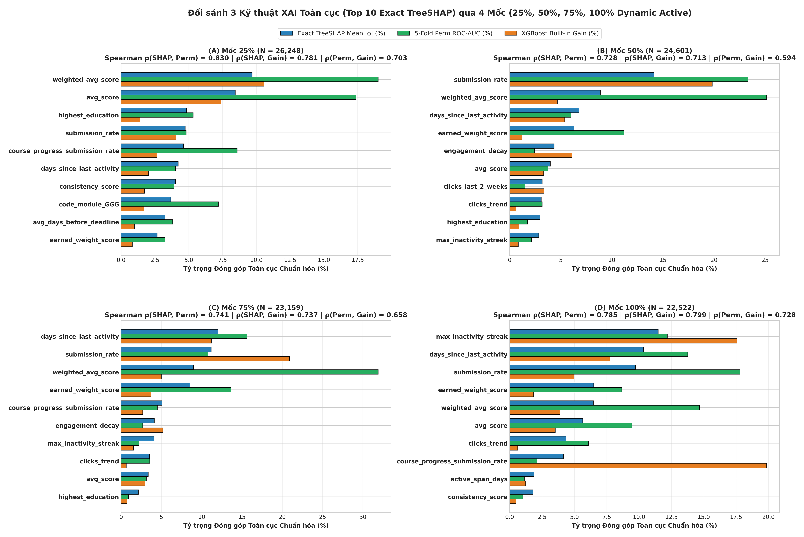

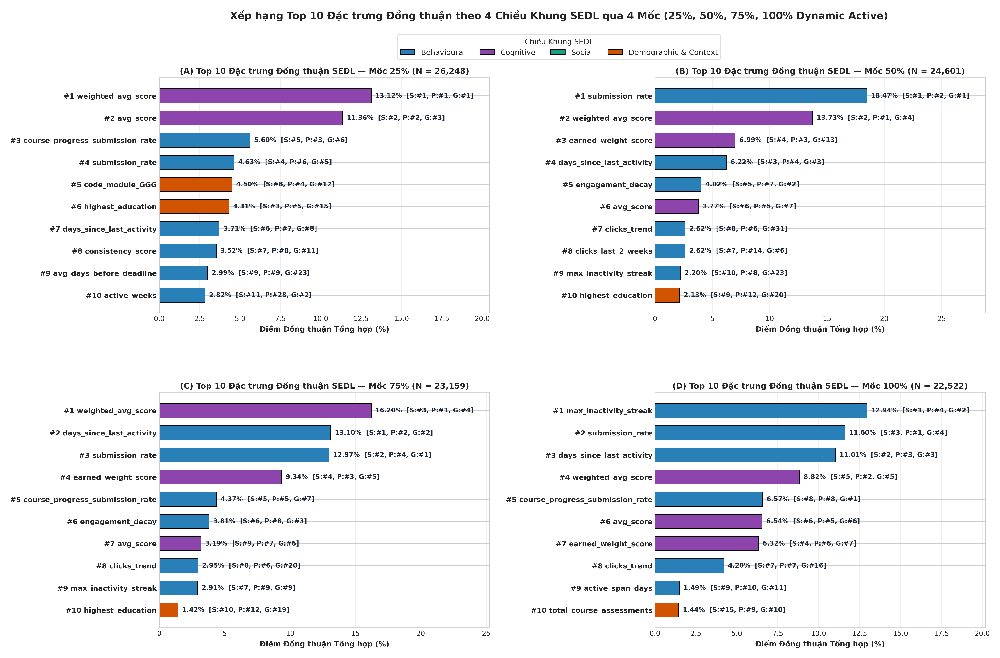

> **Phát hiện phương pháp luận (Collinearity giữa Gain, Permutation và SHAP):** Tại mốc `25%`, `active_weeks` xếp #2 theo Gain (`7.92%`) nhưng tụt xuống #28 theo Permutation (`0.50%`) và #11 theo SHAP (`2.36%`); tương tự tại `100%`, `course_progress_submission_rate` đứng #1 theo Gain (`19.86%`) nhưng đứng #8 theo cả SHAP (`4.14%`) và Permutation (`2.10%`). Kết hợp 3 phương pháp cùng Exact TreeSHAP loại bỏ thiên lệch chọn nhánh gốc và phân bổ công bằng đóng góp giữa các biến tương quan.

---

## 4. Phân phối SHAP Beeswarm qua 4 Mốc & Tiến hóa 4 Chiều SEDL (`25% -> 100%`)

Toàn bộ 114 đặc trưng được phân loại thành 4 chiều theo khung **SEDL** `[Bergdahl et al., 2024]` mở rộng: **`42` Behavioural**, **`29` Cognitive**, **`8` Social**, và **`35` Demographic & Context**. Hình 40 trình bày 4 biểu đồ **Exact TreeSHAP Beeswarm** (Top 12 đặc trưng) cho cả 4 lát cắt `25% (A)`, `50% (B)`, `75% (C)`, `100% (D)`, và Hình 41 tổng hợp diễn biến tỷ trọng (%) lẫn cường độ tuyệt đối của 4 chiều SEDL `(A)–(B)`:

| Mốc Tiến độ (`dynamic_active`) | Số mẫu ($N$) | ROC-AUC 5-Fold | Tổng Mean $\|\phi\|$ | Behavioural (%) | Cognitive (%) | Social (%) | Demographic & Context (%) | Top 2 Đặc trưng SHAP Dẫn đầu Mốc |
|:---:|---:|---:|---:|---:|---:|---:|---:|---|
| **25%** | 26,248 | 0.8480 | 3.7888 | **40.82%** (`1.5465`) | **36.08%** (`1.3670`) | **2.08%** (`0.0789`) | **21.02%** (`0.7965`) | `weighted_avg_score` (`0.3669`), `avg_score` (`0.3195`) |
| **50%** | 24,601 | 0.9068 | 4.6299 | **52.88%** (`2.4481`) | **32.20%** (`1.4911`) | **2.22%** (`0.1029`) | **12.70%** (`0.5879`) | `submission_rate` (`0.6535`), `weighted_avg_score` (`0.4108`) |
| **75%** | 23,159 | 0.9457 | 5.4936 | **56.00%** (`3.0764`) | **31.89%** (`1.7517`) | **3.13%** (`0.1721`) | **8.98%** (`0.4934`) | `days_since_last_activity` (`0.6591`), `submission_rate` (`0.6136`) |
| **100%** | 22,522 | 0.9655 | 6.4703 | **59.38%** (`3.8419`) | **30.51%** (`1.9740`) | **2.27%** (`0.1470`) | **7.84%** (`0.5075`) | `max_inactivity_streak` (`0.7427`), `days_since_last_activity` (`0.6689`) |

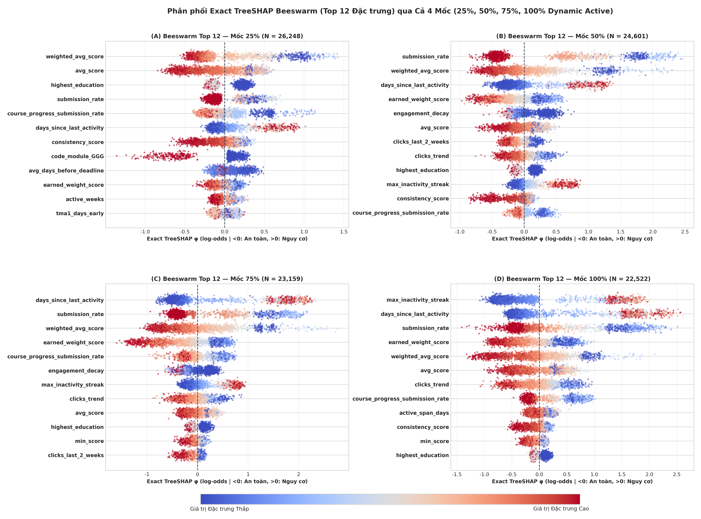

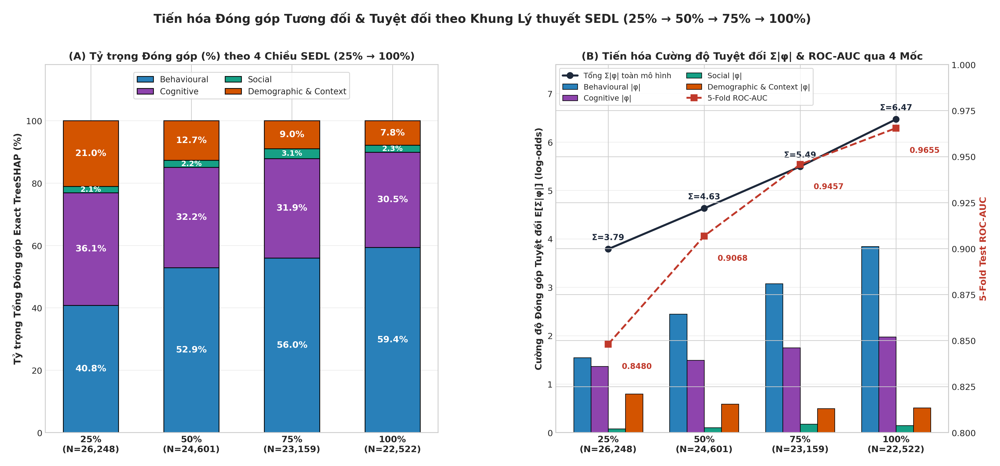

- **Giai đoạn khởi đầu (25%, Hình 40A):** `Demographic & Context` chiếm `21.02%` (`highest_education = 0.1829`, `code_module_GGG = 0.1386`) bên cạnh điểm bài đầu kỳ (`Cognitive = 36.08%`).
- **Giai đoạn giữa đến cuối khóa (50% → 75% → 100%, Hình 40B–D & Hình 41):** `Behavioural` tăng vọt từ `40.82%` lên `59.38%`, tổng $\sum |\phi|$ tăng $1.71\times$ (`3.7888 → 6.4703`) giúp `ROC-AUC` bứt phá từ `0.8480` lên `0.9655`. Trong khi đó `Demographic & Context` giảm gần 3 lần xuống `7.84%`, khẳng định nỗ lực duy trì học tập trong khóa học áp đảo hoàn toàn xuất phát điểm nhân khẩu học.

---

## 5. Tác động Biên Phi tuyến: Partial Dependence (PDP), ICE & SHAP Dependence qua 4 Mốc

Áp dụng **PDP** `[Friedman, 2001]`, **ICE** `[Goldstein et al., 2015]` ($800$ sinh viên mẫu/mốc) và **SHAP Dependence** trên đơn vị gốc cho **5 đặc trưng trọng tâm** qua cả 4 mốc (`25%, 50%, 75%, 100%`):

| Đặc trưng Trọng tâm | Mốc | Khoảng PDP (`P_min → P_max`) | Biên độ ($\Delta P$) | Ngưỡng uốn (Inflection) | $P$ tại uốn | Ngưỡng đảo dấu $\phi=0$ |
|---|:---:|---|---:|---:|---:|---:|
| **`weighted_avg_score`** | 25% / 50% / 75% / 100% | `0.4166→0.6748` / `0.3824→0.7013` / `0.3098→0.6914` / `0.2960→0.5144` | 0.2583 / 0.3189 / **0.3816** / 0.2184 | `42.5 / 47.5 / 42.5 / 42.5` điểm | `0.630 / 0.567 / 0.544 / 0.451` | `63.13 / 69.15 / 68.10 / 68.90` điểm |
| **`submission_rate`** | 25% / 50% / 75% / 100% | `0.4416→0.5131` / `0.4058→0.6422` / `0.3663→0.4895` / `0.3512→0.6007` | 0.0715 / 0.2364 / 0.1233 / **0.2495** | `1.00 / 0.85 / 1.00 / 0.48` | `0.442 / 0.522 / 0.366 / 0.512` | `0.90 / 0.85 / 0.89 / 0.79` |
| **`days_since_last_activity`** | 25% / 50% / 75% / 100% | `0.4397→0.5456` / `0.4163→0.5329` / `0.3727→0.5740` / `0.3561→0.5370` | 0.1060 / 0.1166 / **0.2013** / 0.1808 | `20.62 / 0.00 / 48.00 / 48.00` ngày | `0.498 / 0.416 / 0.532 / 0.452` | `7.60 / 15.90 / 28.97 / 38.79` ngày |
| **`consistency_score`** | 25% / 50% / 75% / 100% | `0.3837→0.4949` / `0.3979→0.4596` / `0.3736→0.3900` / `0.3474→0.3810` | **0.1112** / 0.0618 / 0.0164 / 0.0336 | `0.90 / 0.90 / 0.88 / 0.85` | `0.429 / 0.425 / 0.388 / 0.366` | `0.82 / 0.82 / 0.82 / 0.79` |
| **`max_inactivity_streak`** | 25% / 50% / 75% / 100% | `0.4438→0.4753` / `0.4094→0.5263` / `0.3689→0.4264` / `0.3351→0.4834` | 0.0315 / 0.1169 / 0.0575 / **0.1483** | `33.0 / 63.0 / 66.0 / 69.0` ngày | `0.464 / 0.523 / 0.402 / 0.464` | `16.27 / 29.07 / 29.59 / 56.85` ngày |

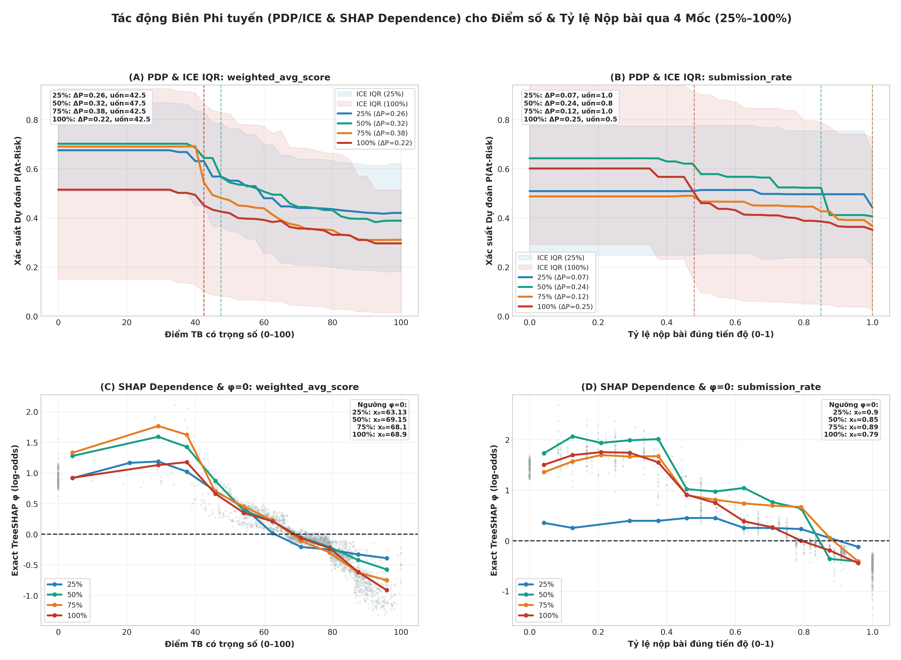

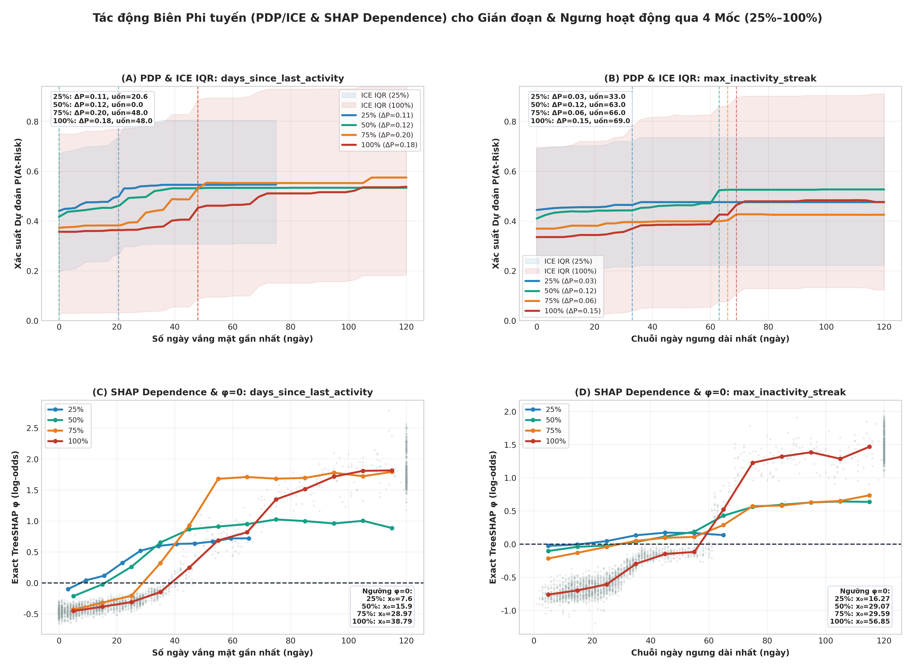

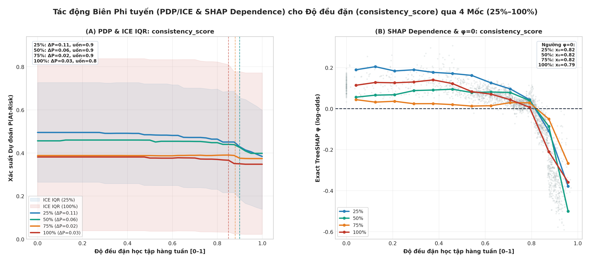

---

## 6. Giải thích Cục bộ (Local XAI): 16 Case Studies, Quỹ đạo Cá nhân & LIME qua 4 Mốc

### 6.1. Phân tích 16 Case Studies OOF & Quỹ đạo Dọc Thời gian (`25% -> 100%`)

Bốn góc Ma trận Nhầm lẫn OOF (`TP, FP, TN, FN`) được giải thích bằng **Exact TreeSHAP Waterfall** tại cả 4 mốc (Hình 45 -- Hình 48):
- **25%:** `TP` `#683094` (`FFF-2014J`, `Fail`, $P=0.8999, f=+2.1963$, LIME $R^2=0.6971$), `FP` `#570237` (`DDD-2013J`, `Pass`, $P=0.7199, f=+0.9437$, LIME $R^2=0.6965$), `TN` `#635573` (`CCC-2014J`, `Distinction`, $P=0.0601, f=-2.7506$, LIME $R^2=0.6262$), `FN` `#2669816` (`AAA-2013J`, `Fail`, $P=0.1601, f=-1.6572$, LIME $R^2=0.6655$).
- **50%:** `TP` `#271274` (`FFF-2013J`, `Fail`, $P=0.8998, f=+2.1951$, LIME $R^2=0.7055$), `FP` `#602454` (`DDD-2014B`, `Pass`, $P=0.7197, f=+0.9429$, LIME $R^2=0.7116$), `TN` `#510195` (`DDD-2013B`, `Pass`, $P=0.0600, f=-2.7515$, LIME $R^2=0.6675$), `FN` `#444783` (`DDD-2014J`, `Withdrawn`, $P=0.1602, f=-1.6569$, LIME $R^2=0.6891$).
- **75%:** `TP` `#2082180` (`DDD-2013J`, `Withdrawn`, $P=0.8998, f=+2.1953$, LIME $R^2=0.7104$), `FP` `#689333` (`BBB-2014J`, `Pass`, $P=0.7198, f=+0.9437$, LIME $R^2=0.6783$), `TN` `#633983` (`FFF-2014B`, `Pass`, $P=0.0600, f=-2.7514$, LIME $R^2=0.6985$), `FN` `#236090` (`FFF-2014J`, `Fail`, $P=0.1610, f=-1.6508$, LIME $R^2=0.7197$).
- **100%:** `TP` `#501652` (`CCC-2014B`, `Fail`, $P=0.9000, f=+2.1970$, LIME $R^2=0.7273$), `FP` `#674437` (`DDD-2014J`, `Pass`, $P=0.7200, f=+0.9444$, LIME $R^2=0.7636$), `TN` `#442987` (`GGG-2014J`, `Pass`, $P=0.0600, f=-2.7510$, LIME $R^2=0.7854$), `FN` `#618875` (`CCC-2014J`, `Fail`, $P=0.1603, f=-1.6560$, LIME $R^2=0.6841$).

**Quỹ đạo dọc thời gian SV `#2137413` (`EEE-2013J`, `Fail`):** `25%` ($P = 0.3006 < 0.42$, an toàn nhờ `avg_score=87.0` $\phi=-0.3578$) $\rightarrow$ `50%` ($P = 0.8499 > 0.51$, bị gắn cờ do `submission_rate=0.67` $\phi=+0.9868$ và `clicks_trend=-8.96` $\phi=+0.4207$) $\rightarrow$ `75%` ($P = 0.9944$, `days_since_last_activity=78.0` $\phi=+2.0633$) $\rightarrow$ `100%` ($P = 0.9991$, `days_since_last_activity=145.0` $\phi=+1.9255$).

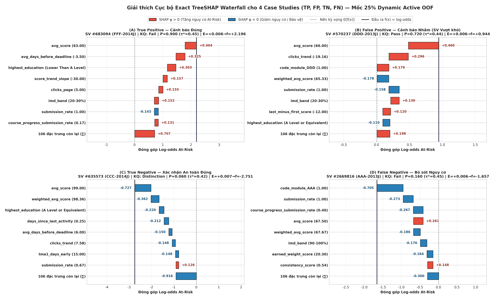

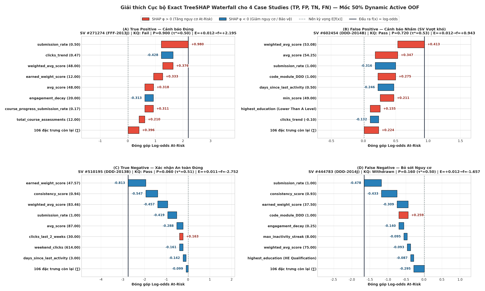

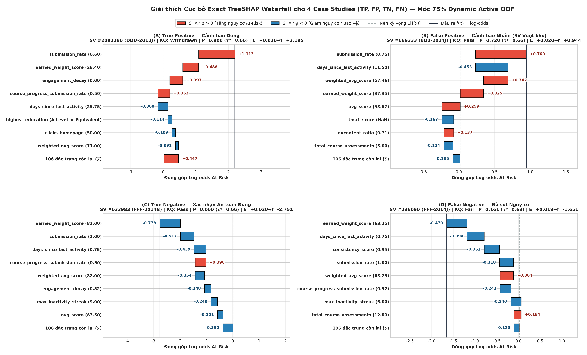

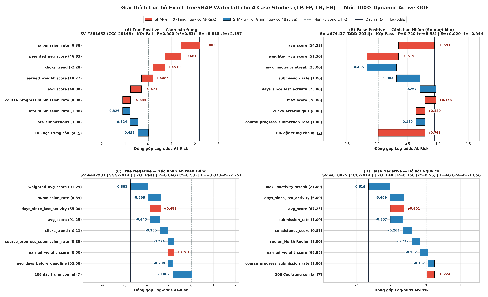

### 6.2. Kiểm chứng Độ trung thực Local Surrogate LIME vs. Exact TreeSHAP qua 4 Mốc

Trên 200 sinh viên OOF phân tầng tại mỗi mốc ($1{,}200$ nhiễu Gaussian, `Ridge(alpha=1.0)` trên log-odds, `[Ribeiro et al., 2016]`):

| Mốc | Số mẫu OOF | Local Weighted $R^2$ (TB $\pm$ SD / Med) | Cosine Similarity | Spearman $\rho$ (Active / Med) | Spearman $\rho$ (All 114) | Top-10 Overlap |
|:---:|---:|---|---:|---|---:|---:|
| **25%** | 200 | $0.6755 \pm 0.0432$ (`0.6761`) | 0.5869 | `0.5351` (`0.5707`) | 0.3126 | 50.40% |
| **50%** | 200 | $0.6764 \pm 0.0513$ (`0.6747`) | **0.6101** | `0.5952` (`0.6157`) | 0.3184 | 52.90% |
| **75%** | 200 | $0.6744 \pm 0.0499$ (`0.6743`) | 0.6026 | **`0.6069`** (`0.6664`) | 0.3076 | 53.20% |
| **100%** | 200 | **`0.6939 ± 0.0549`** (`0.6973`) | 0.5738 | `0.5896` (`0.6351`) | **0.3281** | **56.45%** |

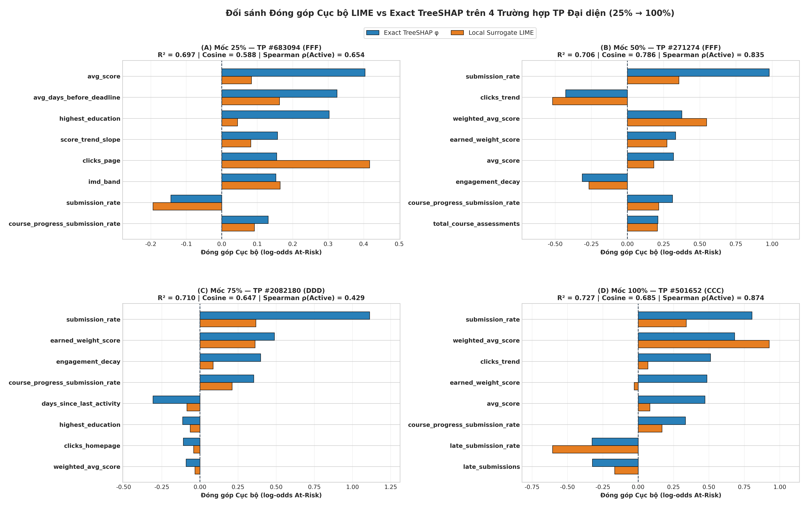

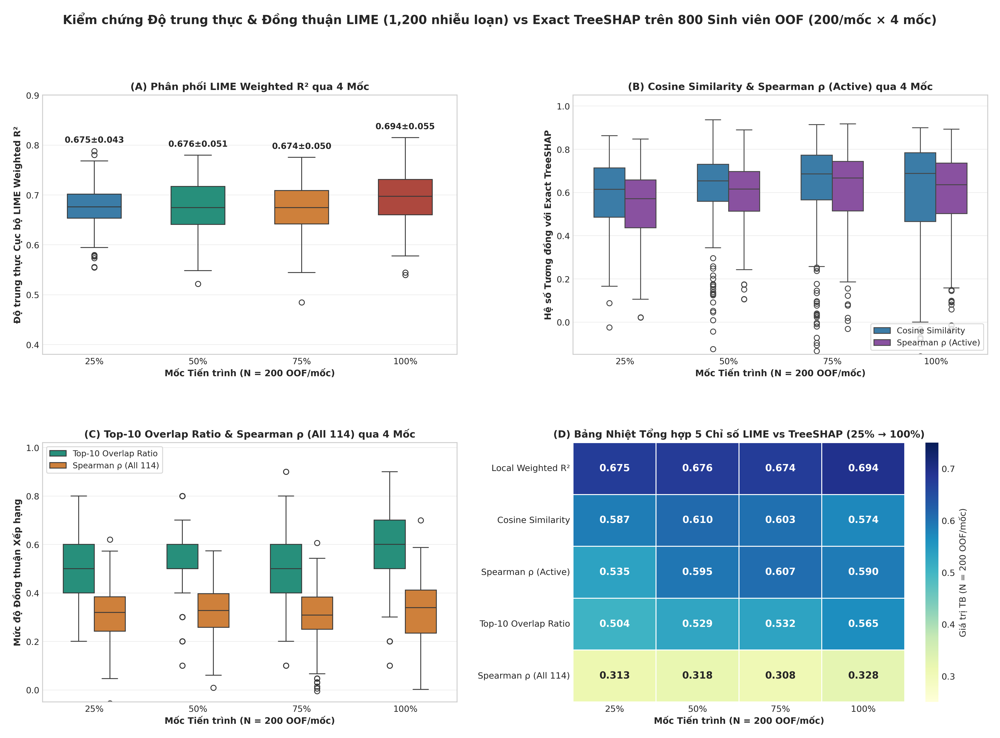

---

## 7. Kiểm định Công bằng Nhân khẩu học (Subgroup Fairness Audit) qua 4 Mốc (`25% -> 100%`)

Trên toàn bộ dự đoán 5-Fold OOF tại cả 4 mốc (`25%, 50%, 75%, 100%`, áp dụng ngưỡng $\tau^*_k$), nghiên cứu kiểm định 5 thuộc tính theo **Equal Opportunity** ($\Delta\text{TPR}$) `[Hardt et al., 2016]`, **Predictive Equality** ($\Delta\text{FPR}$), **Disparate Impact Ratio** (`[0.80, 1.25]`) `[Feldman et al., 2015]`, `ROC-AUC` và **Brier Score** `[Brier, 1950]`:

| Thuộc tính | Mốc `25%` ($\Delta\text{TPR} / \Delta\text{FPR} / \text{DI}$ / 4/5) | Mốc `50%` ($\Delta\text{TPR} / \Delta\text{FPR} / \text{DI}$ / 4/5) | Mốc `75%` ($\Delta\text{TPR} / \Delta\text{FPR} / \text{DI}$ / 4/5) | Mốc `100%` ($\Delta\text{TPR} / \Delta\text{FPR} / \text{DI}$ / 4/5) |
|---|---|---|---|---|
| **`gender`** (`M` ref) | `0.0614 / 0.0051 / [0.912, 1.000]` (**ĐẠT**) | `0.0524 / 0.0018 / [0.906, 1.000]` (**ĐẠT**) | `0.0532 / 0.0027 / [0.888, 1.000]` (**ĐẠT**) | `0.0457 / 0.0049 / [0.890, 1.000]` (**ĐẠT**) |
| **`disability`** (`N` ref) | `0.0701 / 0.1111 / [1.000, 1.317]` (Không) | `0.0460 / 0.0636 / [1.000, 1.309]` (Không) | `0.0308 / 0.0160 / [1.000, 1.259]` (Không) | **`0.0014 / 0.0145 / [1.000, 1.209]` (ĐẠT)** |
| **`age_band`** (`0-35` ref) | `0.1795 / 0.1440 / [0.527, 1.000]` (Không) | `0.1215 / 0.0694 / [0.544, 1.000]` (Không) | `0.0845 / 0.0274 / [0.525, 1.000]` (Không) | `0.0475 / 0.0189 / [0.544, 1.000]` (Không) |
| **`imd_band`** (`30-40%` ref) | `0.2543 / 0.2202 / [0.595, 1.352]` (Không) | `0.1453 / 0.1214 / [0.570, 1.342]` (Không) | `0.1212 / 0.0451 / [0.556, 1.391]` (Không) | `0.1219 / 0.0366 / [0.477, 1.334]` (Không) |
| **`region`** (`Scotland` ref) | `0.1027 / 0.0911 / [0.807, 1.103]` (**ĐẠT**) | `0.0809 / 0.0638 / [0.789, 1.149]` (Không) | `0.1146 / 0.0388 / [0.736, 1.176]` (Không) | `0.0954 / 0.0226 / [0.746, 1.187]` (Không) |

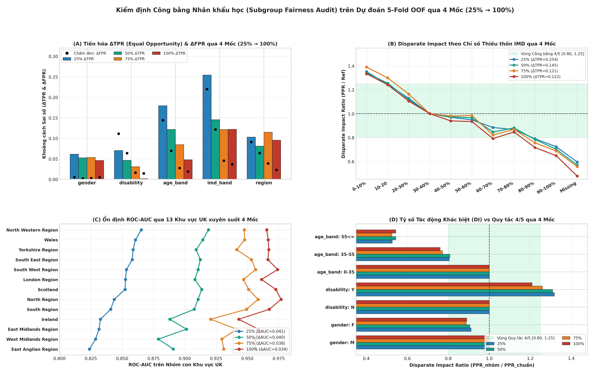

**Nhận xét chính:** Khi tích lũy thêm dữ liệu hành vi (`25% → 100%`), $\Delta\text{TPR}$ và $\Delta\text{FPR}$ thu hẹp mạnh trên mọi thuộc tính (đặc biệt `disability` đạt chuẩn 4/5 ở `100%` với $\Delta\text{TPR} = 0.0014$; `age_band` giảm $\Delta\text{TPR}$ `3.8×` và $\Delta\text{FPR}$ `7.6×`). Độ phân tách $\Delta\text{ROC-AUC}$ ở cả 4 mốc đều nhỏ ($\le 0.0500$ ở `25%`, $\le 0.0338$ ở `100%`), khẳng định sai khác `DI` chủ yếu bắt nguồn từ chênh lệch tỷ lệ nền (`base_rate`) vốn có trong OULAD `[DCLG, 2015]`.

---

## 8. Ứng dụng Demo Tương tác Streamlit Đa mốc (`demo/app.py`)

Ứng dụng [`demo/app.py`](file:///c:/Users/mrore/Project_I/demo/app.py) đóng gói trọn vẹn pipeline tiền xử lý 114 đặc trưng và gói 5-Fold Out-of-Fold đa mốc [`models/best_model_5fold_4milestones.joblib`](file:///c:/Users/mrore/Project_I/models/best_model_5fold_4milestones.joblib) để chấm điểm **0% Data Leakage** trên **tất cả 4 mốc (`25%, 50%, 75%, 100% dynamic_active`)** với cơ chế tự động đồng bộ ngưỡng tối ưu ($\bar{\tau}^* = 0.432; 0.496; 0.620; 0.574$).

### 8.1. Năm Tab Chức năng Cốt lõi (Đa mốc `25%–100%`)

| Tab | Tên Chức năng | Thành phần Tương tác & Giá trị Thực tiễn |
|:---:|---|---|
| **1** | **Tổng quan Cảnh báo & Top 10 XAI** | 5 thẻ KPI trực tiếp theo mốc (`25%`: `26,248` lượt / `ROC-AUC = 0.8480`; `50%`: `24,601` / `0.9068`; `75%`: `23,159` / `0.9457`; `100%`: `22,522` / `0.9655`), biểu đồ Donut 4 mức rủi ro, đối sánh theo `code_module` / `code_presentation`, Ma trận Nhầm lẫn động và bảng **Top 10 Đặc trưng Đồng thuận + Spearman** theo từng mốc. |
| **2** | **Danh sách Ưu tiên Can thiệp** | Tìm kiếm nhanh theo `id_student`, lọc đa mức rủi ro và ngưỡng $\tau$, tô gradient cột `Risk Score`, và xuất danh sách `.csv` (UTF-8 BOM) cho cố vấn học tập điều phối can thiệp. |
| **3** | **Chẩn đoán Cá nhân, Exact TreeSHAP & What-If** | Chọn nhanh 16 **Case Studies (`TP/FP/TN/FN`)** theo từng mốc hoặc tra cứu SV bất kỳ, đồng hồ đo xác suất từ đúng Fold OOF, **biểu đồ Exact TreeSHAP Top 12 tác nhân Log-Odds** (`pred_contribs=True`), **Radar 4 chiều SEDL**, 4 khuyến nghị sư phạm cá nhân hóa và **What-If Counterfactual Simulator** 6 thanh trượt tính $\Delta P(\text{At-Risk})$ tức thời. |
| **4** | **Xu hướng SEDL & Kiểm định Công bằng** | Biểu đồ phân bố đặc trưng giữa `An toàn` vs `Nguy cơ`, **diễn tiến tỷ trọng Exact TreeSHAP theo 4 chiều SEDL (`25% → 100%`)**, và kiểm định **Subgroup Fairness Audit** động theo ngưỡng $\tau$ cho 5 thuộc tính (`gender`, `age_band`, `imd_band`, `disability`, `region`) kèm bảng tổng hợp 4 mốc và cảnh báo quy tắc 4/5. |
| **5** | **Đối sánh Đa mốc (`25% → 100%`)** | Đường cong tiến hóa 10 mô hình Tuần 7 qua 4 lát cắt, bảng thẩm định **5-Fold OOF & LIME $R^2$ 4 mốc**, và **Quỹ đạo Rủi ro OOF Dọc thời gian** cho từng sinh viên cụ thể qua `25% → 50% → 75% → 100%`. |

### 8.2. Đóng gói & Kiểm thử Vận hành

- **Đóng gói mã nguồn & tài liệu:** [`requirements.txt`](file:///c:/Users/mrore/Project_I/requirements.txt) ghim phiên bản tương thích Python 3.12.10; [`README.md`](file:///c:/Users/mrore/Project_I/README.md) cung cấp đầy đủ hướng dẫn cài đặt, tái lập 7 notebook và lệnh khởi chạy `streamlit run demo/app.py`.
- **Kiểm thử thực tế (Live Verification):** Đã kiểm tra biên dịch cú pháp (`py_compile`), chạy thử máy chủ Streamlit thực tế và kiểm tra bằng trình duyệt headless Chrome trên toàn bộ 5 Tab và cả 4 mốc (`25%, 50%, 75%, 100%`): `/_stcore/health` và `/` trả về HTTP `200`, `0` ngoại lệ (`stException`), đồng thời xuất ảnh chụp màn hình tại `demo/assets/` và ảnh tổng hợp Hình 52.

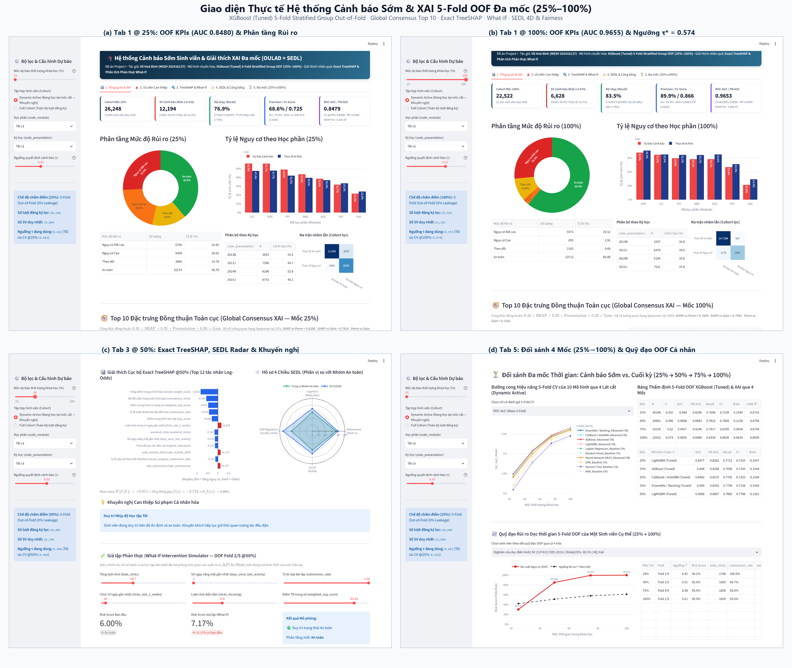

---

## 9. Đối chiếu Tiêu chí Hoàn thành (DoD) Tuần 8 & Tuân thủ `AGENTS.md`

| Tiêu chí Deliverable Tuần 8 | Kết quả Thực tế Đạt được | Trạng thái |
|---|---|---|
| **Notebook `07_model_explanation.ipynb` tự chủ 100% (4 mốc)** | Thực thi trọn vẹn qua cả 4 mốc `25%–100%`, 0 lỗi, **12/12 Unit Tests PASSED** | **HOÀN THÀNH** |
| **5 Kỹ thuật XAI (Gain, Permutation, Exact TreeSHAP, LIME, PDP/ICE)** | Đầy đủ cả 4 mốc ($96{,}530$ lượt OOF) + 800 mẫu LIME (`R²=0.674–0.694`) | **HOÀN THÀNH** |
| **Top 10 Đặc trưng, 16 Case Studies, Quỹ đạo & Liên hệ SEDL** | Xuất đủ bảng đồng thuận 4 mốc, 16 Case Studies, quỹ đạo SV `#2137413`, 4 chiều SEDL | **HOÀN THÀNH** |
| **Subgroup Fairness Audit đa mốc (`25% -> 100%`)** | Kiểm định 5 thuộc tính (`gender, disability, age_band, imd_band, region`) qua 4 mốc | **HOÀN THÀNH** |
| **Ứng dụng Streamlit `demo/app.py` + `requirements.txt` + `README.md`** | 5 Tab OOF 4 mốc hoàn chỉnh, live HTTP 200, 0 lỗi qua 4 mốc, ảnh chụp `demo/assets/` & Hình 52 | **HOÀN THÀNH** |
| **Hình vẽ chuyên sâu (Hình 38 – Hình 52)** | 15 hình PNG đa mốc chất lượng cao ($\le 4$ biểu đồ con/hình) tại `reports/figures/` | **HOÀN THÀNH** |
| **Tuân thủ `AGENTS.md`** | 0 thư mục `src/`, 0 script rác, 0 file `.json/.csv` trong `reports/`, 0 đại từ tập thể | **ĐẠT 100%** |
